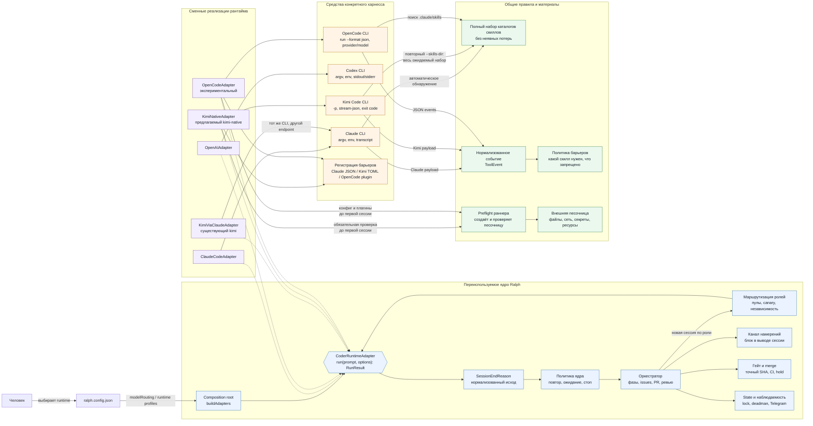

# Ralph: переключение харнессов

Оркестратор, гейт и канал намерений должны оставаться общими. Но смена харнесса
не сводится к подмене CLI: адаптер обязан нормализовать причину завершения, а ядро —
не зависеть от текстовых маркеров Claude. Это целевой контракт для `kimi-native`,
а не утверждение, что текущий раннер уже переносим без изменений.

Чем харнессы различаются по существу — правила, скиллы, имена и поля инструментов, MCP,
слои конфига, доказательство загрузки скилла — и как они подключаются пакетом адаптера, а не
правкой ядра, разобрано отдельно: [харнесс как пакет адаптера](harness-contract.md). Сегодня
барьеры канона принимают вход в форме Claude Code; нормализованное событие оттуда — цель
Фаз 16c–16f.



## Граница контракта завершения

`failureKind` описывает прежде всего сбой запуска процесса и не заменяет причину
завершения уже работавшей сессии. Для целевого контракта нужен отдельный союз:

```ts
type SessionEndReason =
    'completed' | 'api-limit' | 'auth' | 'turn-limit' | 'interrupted' | 'timeout' | 'unknown';

type RunResult = {
    code: number;
    output: string;
    endReason?: SessionEndReason;
    retryAfterMs?: number;
    failureKind?: SpawnFailureKind;
    systemErrorCode?: string;
};
```

Набор принят в Фазе 16 (#112) по решениям, которые ядро действительно принимает: вход,
отвергнутый провайдером (`auth`), чинится человеком и не ждёт окна, как лимит; разорванный
поток и перегрузка (`interrupted`) — один исход, потому что ядро переживает их одинаково.
Неразборчивый вывод отдельным исходом не выделен: адаптер, не узнавший вывод, отдаёт
`unknown`. Классификаторы и фикстуры — `adapters/session-end.ts` и
`adapters/__fixtures__/session-end-*.json`.

Адаптер распознаёт исход по структурированным событиям CLI, коду и выводу. `output`
остаётся диагностикой, а не носителем политики. Решение о повторе, ожидании,
фолбэке и остановке принимает только оркестратор.

| Событие или исход                | Кто распознаёт                                   | Что решает ядро                                                                   |
| -------------------------------- | ------------------------------------------------ | --------------------------------------------------------------------------------- |
| Успешное завершение              | Адаптер: `completed`                             | Применить намерения и продолжить шаг                                              |
| Лимит провайдера                 | Адаптер: `api-limit`, при наличии `retryAfterMs` | Один разрешённый фолбэк либо ограниченное ожидание                                |
| Исчерпание ходов                 | Адаптер: `turn-limit`                            | Применить намерения, затем новая сессия в пределах `retries`                      |
| Бинарь временно недоступен       | Адаптер: `failureKind = runtime-unavailable`     | Ограниченный backoff, не обычный провал issue                                     |
| Тайм-аут сессии                  | Адаптер: `timeout`                               | Как прочее падение по коду; в запись попытки, не маскируется под лимит            |
| Обрыв потока, перегрузка, прокси | Адаптер: `interrupted`                           | Ревью без намерений — повтор с паузой; иначе по коду: при 0 — успех, строка в лог |
| Вход отвергнут                   | Адаптер: `auth`                                  | Без ожидания и повтора; кодер-итерация — стоп петли с пушем «вход отвергнут»      |
| Прочее, неизвестная формулировка | Адаптер не угадывает: `unknown`                  | «Прочее» в лог, не успех даже при коде 0; без текстовой догадки в ядре            |

С Фазы 16 ядро текст вывода для решений о повторе не читает: признаки, которые оно
искало регулярками, переехали в классификаторы Claude и Codex, а барьер
`tests/session-end-purity.test.ts` краснеет на регулярке по выводу сессии в `core/`.

## Быстрый вход модели через совместимый чужой CLI

Быстрый вход использует существующий харнесс с совместимым API-провайдером.
Уже сейчас `kimi` в реестре `coderRuntime` означает Claude CLI с endpoint Moonshot,
а `openai` — отдельный Codex CLI. `modelRouting` выбирает зарегистрированный
рантайм и модель для issue;
`adapters.coderRuntime` задаёт рантайм остальных сессий по умолчанию. Имя поля
`provider` в нынешнем `modelRouting` фактически обозначает ключ рантайма, поэтому
при расширении маршрутов эти две оси нельзя смешивать.

Для быстрого ручного входа скрипт может оставаться короткой операторской командой.
В автономной петле выбор должен быть зафиксирован в конфигурации Ralph на границе
**новой сессии**: харнесс, совместимый API-провайдер, точный endpoint, модель и имя
env-переменной с токеном образуют один именованный профиль запуска. Секрет в конфиг
не записывается. В целевой схеме скрипт выбирает профиль при старте раннера. Он
не переписывает глобальные настройки CLI и не переключает провайдера внутри уже
работающей сессии.

Перед запуском Ralph сверяет совместимость API, модель, способ авторизации и
настройки CLI, которые могут переопределить окружение дочернего процесса. Затем
запускает свежий процесс с провайдерскими переменными только выбранного профиля
и пишет в лог имя профиля, харнесс, хост endpoint и модель без секрета. Для Claude
CLI эта проверка существенна:
его [`settings.json` может переопределить переменные, унаследованные от процесса](https://code.claude.com/docs/en/env-vars).

Пока поддержан один такой маршрут — Kimi через Claude CLI, — достаточно нынешнего
адаптера. Именованные профили и отдельный разовый ключ запуска вроде
`--runtime-profile` вводятся при появлении второго совместимого провайдера или
потребности часто переключать их без правки конфига. Несовместимый API требует
своего адаптера или нативного CLI; произвольный URL не считается доказательством
совместимости.

## Намерения по независимым контурам

Цель — не собрать максимальное число CLI, а переживать отказы провайдера и
харнесса независимо. Маршрут описывается парой **харнесс + провайдер** с конкретной
моделью; пара независимых контуров у Ralph уже существует.

| Маршрут                     | Роль и граница независимости                                                       |
| --------------------------- | ---------------------------------------------------------------------------------- |
| Claude CLI → Anthropic      | Действующий базовый контур; Opus — ревью и разбор вахты                            |
| Claude CLI → Moonshot       | Другой провайдер, но тот же харнесс; не резерв при поломке Claude CLI              |
| Codex CLI → OpenAI          | Действующий второй независимый контур и резерв; целевой независимый ревьюер/арбитр |
| OpenCode → третий провайдер | Экспериментальный третий харнесс; резерв только после проверки маршрута            |
| Kimi Code CLI → Moonshot    | Независимая линия оценки качества Kimi в родном CLI                                |

Claude CLI → Moonshot допускается в ночную петлю, если проходит реальные сценарии:
это рабочий маршрут, а не способ исследовать нативное поведение Kimi Code.
`kimi-native` развивается рядом для такого исследования и не блокирует повышение
устойчивости существующих контуров.

OpenCode рассматривается как третий харнесс: документация подтверждает
[`run --format json` и выбор `provider/model`](https://opencode.ai/docs/cli/),
[плагины с событиями инструментов](https://opencode.ai/docs/plugins/) и
[поиск `.claude/skills`](https://opencode.ai/docs/skills/). Это основание для
эксперимента, но не для объявления его резервом.

### Роли и пулы взаимозаменяемых профилей

Целевая схема — не фиксированная цепочка моделей, а пул допущенных профилей для
каждой роли. Профиль связывает харнесс, провайдера и конкретную модель; допуск
подтверждается canary **этого профиля именно на этой роли**. Kimi, Codex и Claude
могут подменять друг друга без ручной перенастройки, если прошли такой допуск.

| Роль                       | Основное назначение  | Замены и дополнительные мнения                                       |
| -------------------------- | -------------------- | -------------------------------------------------------------------- |
| Написание кода             | Kimi                 | Codex и Claude из допущенного пула                                   |
| Ревью                      | Opus 5.5             | Codex и Kimi, независимые от кодера                                  |
| Планирование PRD           | Основной планировщик | Kimi — второе мнение; Codex — третье для сложных или спорных решений |
| Арбитраж                   | Независимый профиль  | Другой допущенный профиль, не участвовавший в споре                  |
| Разбор нестандартной вахты | Opus                 | Другой допущенный профиль; состояние петли остаётся у Ralph          |

Codex — полноправный кандидат на каждую роль, а не только запасной CLI. Его
`maxTurns` имеет режим `best-effort`: отсутствующий в Codex CLI точный аналог
Claude `--max-turns` не изображается гарантированным лимитом. OpenCode до допуска
в резерв остаётся экспериментальным маршрутом.

Ralph выбирает профиль заново на границе каждой новой сессии. Сегодня
`modelRouting` выбирает рантайм кодера по issue и отдельные маршруты для
API-fallback и heal, но не назначает ревьюера и арбитра по роли. Они вызывают
общий выбранный рантайм с другими моделями. Поэтому быстрая
взаимозаменяемость всех ролей требует отдельной маршрутизации кодера, ревьюера,
планировщика и арбитра; добавление модели Codex в `review` само по себе харнесс
не переключит.

**Кодер и ревьюер назначаются совместно.** Если код после Kimi продолжил Claude,
ревью уходит независимому Codex. Если независимый ревьюер недоступен, Ralph
удерживает merge: самопроверка автором кода, даже в свежей сессии, не выдаётся за
независимое ревью.

Замена происходит только после контрольной точки, описанной в политике fallback.
Новый ревьюер заново получает diff и требования; планировщик — исходную задачу и
уже зафиксированные решения; арбитр — конкретную находку и возражение в свежем
контексте. Второе и третье мнения при PRD разбирают факты независимо, а
разногласие не решается подсчётом голосов. «Вахта» и состояние остаются у Ralph:
Opus или его замена разбирает нестандартные ситуации, но не хранит состояние петли.

Независимый арбитр устанавливает, воспроизводится ли дефект и какой вариант
исправления безопаснее. Неустранённый спор сохраняет штатный `blocked` и не
открывает merge.

### Политика fallback

Fallback меняет **отказавший контур**, а не обязательно харнесс и провайдера
одновременно:

- квота или недоступность API → другой провайдер;
- отказ CLI → другой харнесс;
- полностью независимый маршрут → проверенный резерв, но не обязательный первый шаг.

Посреди незаконченного issue предпочтительнее наименьшее изменение поведения
агента. Красный гейт, обычная ошибка реализации и `unknown` не вызывают failover.

Перед любым повтором другим маршрутом ядро обязано применить либо явно сохранить
намерения попытки, зафиксировать состояние worktree и HEAD, затем запустить новую
сессию с продолжением работы. Число смен маршрута ограничено конфигурацией; повтор
вслепую с тем же состоянием запрещён. Выбывший профиль получает cooldown и
возвращается в пул только после повторной проверки, а не по истечении паузы сам.

### Допуск OpenCode в fallback

1. Адаптер отдаёт `SessionEndReason`, не заставляя ядро искать маркеры Claude.
2. Отрицательный сценарий доказывает, что запрещённая правка остановлена: поиск
   `.claude/skills` сам по себе не доказывает срабатывание барьера.
3. Preflight сверяет итоговую объединённую конфигурацию и полный список плагинов
   с разрешённым профилем. Неожиданный провайдер, плагин или настройка — стоп до
   первой сессии; одна переменная с путём к конфигу не доказывает изоляцию.
4. Canary на реальной карточке проверяет правку, намерения, исход, timeout и
   продолжение состояния другим маршрутом.
5. Только после этих проверок профиль получает статус резервного; регистрация
   бинаря в реестре такого статуса не даёт.

### Порядок реализации

1. `SessionEndReason` и перенос распознавания исходов в адаптеры.
2. Сверка состояния worktree и намерений перед любым повтором.
3. Именованные профили «харнесс + провайдер + модель + авторизация».
4. Пулы профилей по ролям, совместное назначение кодера и ревьюера и удержание
   merge без независимого ревью.
5. Экспериментальный OpenCode с одним провайдером.
6. Canary и отрицательные сценарии барьеров.
7. Допуск проверенного профиля в fallback.

## Обязательные возможности на старте

Каждый рантайм объявляет возможности явно. Ядро проверяет их до выбора issue;
неподдерживаемая конфигурация не игнорируется. При этом обычный параметр, который
ядро передаёт всем рантаймам, не становится строгим требованием неявно:

```ts
type RunOptions = {
    model?: string;
    maxTurns: number;
    turnLimit?: 'best-effort' | 'required';
    fallbackModel?: string | null;
};
```

Пропущенный `turnLimit` означает `best-effort`: рантайм применяет бюджет, если
умеет, а иначе передаёт его наружу только как диагностику; внешние `maxIterations`
и тайм-аут продолжают действовать. `required` выставляется только явной настройкой
оператора и отклоняется на старте, если рантайм не умеет гарантировать лимит.
Поэтому существующий OpenAI/Codex, сознательно не передающий `maxTurns` в argv,
остаётся допустимым при обычном вызове и отвергает только явный строгий режим.

Реализовано (#118): объявление — поле `capabilities` шва рантайма
(`adapters/runtime-capabilities.ts`, сейчас `turnLimit` и `fallbackModel`), строгость —
ключ `turnLimit` конфига, сверка — `core/runtime-requirements.ts` до выбора issue. Фолбэк-модель
сверяется там же: общий `fallbackModel` у рантайма, объявившего `fallbackModel: false`, — строка
`⚠` с его именем на старте (ключ — настройка Claude-сессий, отказ уронил бы рабочий конфиг с
Codex рядом). Остальные строки таблицы ниже объявляются по мере того, как ядро начинает их
сверять.

| Возможность или условие   | Что объявляет адаптер                        | Реакция ядра на старте                                                       |
| ------------------------- | -------------------------------------------- | ---------------------------------------------------------------------------- |
| Исполняемый файл и версия | Команда проверки и поддерживаемая версия     | Остановка при отсутствии или несовместимости                                 |
| Модель и авторизация      | Требуемые имена env, без значений секретов   | Остановка до первого запроса                                                 |
| Причины завершения        | Набор распознаваемых `SessionEndReason`      | Не допускать нераспознанный CLI как production-runtime                       |
| `maxTurns`                | `best-effort` или гарантированный `required` | Отклонить только явный `required`, если его нельзя исполнить                 |
| Fallback-модель           | Поддержана или нет                           | Не имитировать fallback внешними повторами                                   |
| Каталоги скиллов          | Полный явный список                          | Проверить наличие каждого обязательного каталога                             |
| Хуки и барьеры            | Зарегистрированные события и способ аудита   | Не считать fail-open хук единственной защитой                                |
| Песочница                 | Требуется ли и какой профиль                 | Для `kimi-native`: до песочницы — только эксперимент оператора, отказ в роли |

Реализовано для хуков (#119): регистрация барьера в формате каждого харнесса —
`adapters/harness-guard.ts` (Codex — argv, Kimi Code — `[[hooks]]` в `config.toml`, OpenCode —
плагин), отрицательная проба на ней — `core/guard-probe.ts`. Правило старта — «харнесс без
доказанного guard не стартует»: харнесс рантайма неизвестен или его регистрация не передаётся
CLI — отказ с местом в конфиге. Codex проводится в запуск регистрацией в argv, Kimi Code
(#120) — домом CLI, который раннер собирает перед каждой сессией (`config.toml` человека плюс
`[[hooks]]` барьера, вход ссылками), обе — с пробой перед каждой сессией. OpenCode (#121) —
плагином в каталоге `OPENCODE_CONFIG_DIR`, который раннер собирает и пробует так же.

Реализовано для `kimi-native` (#120): адаптер `adapters/kimi-native.ts`, ключ реестра
`kimi-native` рядом с `kimi`. Промпт — файлом с указателем в `-p` (stdin CLI не читает, argv
промпт не вмещает), вывод — stream-json, ядру — только текст ассистента; `turnLimit:
'required'` (`KIMI_LOOP_MAX_STEPS_PER_TURN`), фолбэк-модели нет; готовность до выбора issue —
бинарь, модель и ключи в доме CLI. Contract suite исхода — на фикстурах Kimi Code 2.3.2.
Отрицательная проба барьера проверена и живой сессией: `rm -rf` и `cat .env` заблокированы
хуком. Не сделаны песочница (раздел ниже) и доказательство вызова `Skill`: транскрипта хуку
Kimi не отдаёт.

Пока песочницы нет, `kimi-native` — эксперимент оператора по образцу OpenCode, а не обычный
рантайм. Это меняет требование, а не исполняет его, и строка таблицы выше это говорит (ревью
Фазы 16b): прежнее «отказ запуска без успешной проверки» реализация не держит — статический
`adapters.coderRuntime: 'kimi-native'` идёт на хосте, и под ним проходят все сессии прогона,
включая ревью, где упавший хук Kimi вызов пропускает (класс #120). Целевое требование — раздел
«Песочница как условие запуска» ниже; до него роль рантайму не назначается. Конфиг заявляет `kimiNativeRuntime.status: "experimental"`
дословно, маршрут `modelRouting` в `kimi-native` (метка, фолбэк лимита, эскалация) — отказ до
выбора issue: без этого `apiLimitFallback` отдавал бы ночную сессию на хост без песочницы.
Статический `adapters.coderRuntime: 'kimi-native'` — осознанный прогон оператора, и старт
называет его строкой `🧪`. MCP-инструменты Kimi Code называет `mcp__<сервер>__<инструмент>`,
как Claude Code, и matcher барьера их накрывает; проба это проверяет.

Реализовано для OpenCode (#121), статус «экспериментальный»: адаптер `adapters/opencode.ts`,
ключ реестра `opencode`. `opencode run --format json -m provider/model`, промпт — на stdin
(без позиционного сообщения CLI читает его оттуда), ядру — только события `text`; ошибка CLI
приходит событием `error` в stdout, и исход читается по её имени и HTTP-коду провайдера, а не
по тексту. `turnLimit: 'best-effort'` — бюджета ходов, обрывающего сессию, у CLI нет;
фолбэк-модели нет. Перед каждой сессией раннер кладёт в `runtimeDir/opencode/config` плагин
барьера и `opencode.json` с разрешениями без подтверждений (оба сливаются с конфигом человека,
`--pure` не ставится), пробует плагин и сверяет полноту скиллов: `opencode debug skill` обязан
назвать каждый `.claude/skills/*/SKILL.md` дерева. Готовность до выбора issue — бинарь,
секция `opencodeRuntime` со статусом `"experimental"` и моделью `provider/model`, провайдер и
модель в списке `opencode models <провайдер>` (неизвестную модель сессия узнаёт лишь
«Unexpected server error»), и ключ провайдера у самого CLI — во входе (`auth.json`) или
`provider.<id>.options.apiKey` его конфига: сессия идёт без ключей раннера в env, а список
моделей CLI отдаёт и без ключа. Оба вызова CLI готовности идут тем же env, что сессия.
Отрицательная проба проверена живой сессией: `rm -rf`, `cat .env` и чтение `.env` отменены
плагином, безобидные вызовы прошли.

Плагин барьера строже командных хуков других CLI: хук пропускает вызов только кодом 0, а
упавший, зависший и не запустившийся — блок. MCP-инструмент OpenCode называет
`<сервер>_<инструмент>` без `mcp__`, и разрезать имя обратно нельзя: `_` законен в обоих.
Поэтому плагин отдаёт его барьеру именем `mcp__…` без второго разделителя, которое правило MCP
блокирует всегда, — MCP в сессии OpenCode закрыт целиком (трекер у петли — намерения). Патч
(`apply_patch`) судится по каждому пути из `patchText`, патч без пути — блок. Проба OpenCode
включает MCP-вызов и патч по `.env`. Предел назван: плагин, исполняемый после барьера, может
переписать уже одобренные args; каталог `OPENCODE_CONFIG_DIR` CLI обходит последним, но порядок
вызова обработчиков стендом не сверен.

Статус виден в конфиге и логе. Конфиг заявляет эксперимент дословно (`status: "experimental"`,
другого значения до допуска по canary нет), старт пишет строку `🧪 … ЭКСПЕРИМЕНТАЛЬНЫЙ`, каждая
сессия — `▶ opencode [experimental]`. Ролью считается любой маршрут `modelRouting` (метка,
фолбэк лимита, эскалация лечения): маршрут, приводящий в OpenCode, — отказ до выбора issue.
OpenCode ходит только статическим `adapters.coderRuntime: 'opencode'` — экспериментом
оператора, в котором все сессии прогона, включая ревью, идут через него; независимости
ревьюера это не даёт, и допуска в роль — тоже.

`--skills-dir` у Kimi **заменяет** автоматическое обнаружение пользовательских и
проектных каталогов. Поэтому адаптер либо передаёт флаг повторно для полного
ожидаемого набора, либо использует аддитивный `extra_skill_dirs`. Один флаг на
`.claude/skills` без учёта остальных источников недопустим.

## Песочница как условие запуска `kimi-native`

Песочницу создаёт не хук и не модель, а запускатель раннера до первой кодер-сессии.
Профиль с доверенными Git metadata — отдельный одноразовый контейнер на сессию:

- монтируется выделенное worktree **и необходимые Git metadata**. У linked worktree
  файл `.git` ссылается на метаданные основного репозитория: пути из него и из
  `commondir` должны существовать в контейнере, например по тем же абсолютным путям.
  Метаданные, нужные для commit, доступны на запись; домашний каталог и Docker socket
  хоста при этом остаются недоступны;
- процесс не root, capabilities сброшены, заданы лимиты памяти, CPU, PID и времени;
- окружение собирается по allowlist; токены Telegram и секреты других рантаймов не
  наследуются;
- сетевой доступ ограничивается необходимыми endpoint'ами Kimi, SourceCraft и
  пакетных репозиториев;
- временные файлы и канал намерений доступны только в выделенных каталогах.

Preflight обязан реально поднять профиль и проверить эти ограничения пробным
процессом. Отдельно проверяются `git status`, `git rev-parse --git-dir` и
`--git-common-dir` внутри контейнера плюс запись в необходимые Git metadata. Если
backend песочницы отсутствует, профиль не поднялся или проверка не подтвердила
ограничение, `kimi-native` **не запускается на хосте напрямую**: раннер
останавливается до выбора issue.

**Граница доверия такого профиля:** он защищает хост и посторонние секреты, но
**не защищает Git-данные основного репозитория**. Через общие метаданные linked
worktree агент получает доступ не только к своим коммитам, но и к доступным общим
refs и конфигурации. `git status` эту возможность не ограничивает. Следовательно,
Git-данные репозитория в этом режиме явно считаются доверенными агенту.

Если песочница должна защищать также основной репозиторий, общие Git metadata на
запись агенту не выдаются. Для этого нужен одноразовый изолированный клон со своим
`.git` либо вынос всех Git-операций на сторону раннера через отдельные намерения.
Выбор профиля фиксируется конфигурацией и проверяется preflight; более слабый
профиль с доверенными Git-данными не выдаётся за изоляцию основного репозитория.
Хуки остаются дополнительным барьером качества, но не границей безопасности.

## Что общее, а что нет

| Переиспользуется                       | Зависит от харнесса                |
| -------------------------------------- | ---------------------------------- |
| Очередь issues и фазы                  | Запуск процесса и авторизация      |
| Worktree и git-хореография             | Полный набор каталогов скиллов     |
| PR, ревью и лестница правок            | Регистрация и формат событий хуков |
| Блок намерений в выводе сессии         | Доказательство вызова `Skill`      |
| Гейт, CI и merge                       | Распознавание исхода и API-лимита  |
| Политика повтора, ожидания и остановки | Поддержка `maxTurns` и fallback    |
| Смысл правил и запретов                | Механика разрешений и песочницы    |
