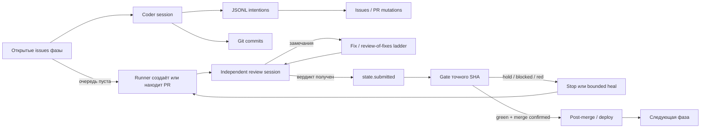
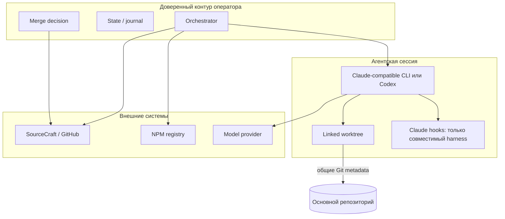
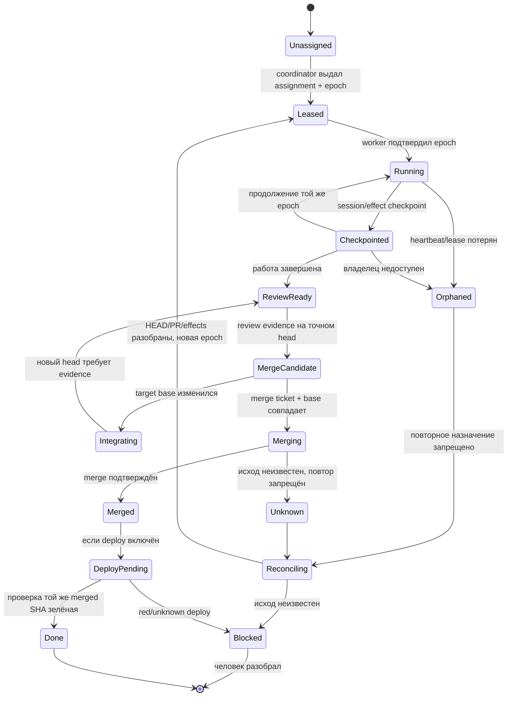
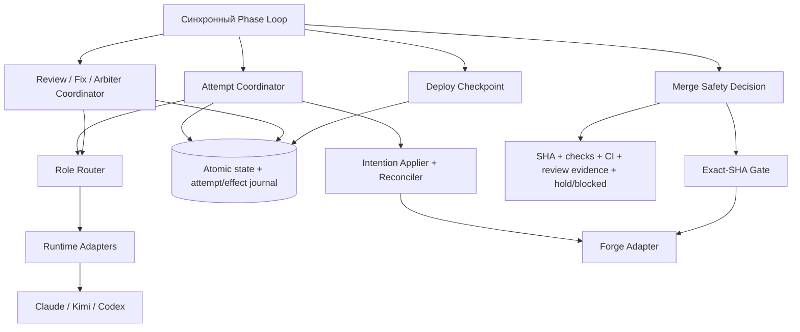
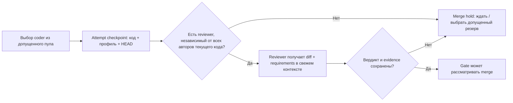
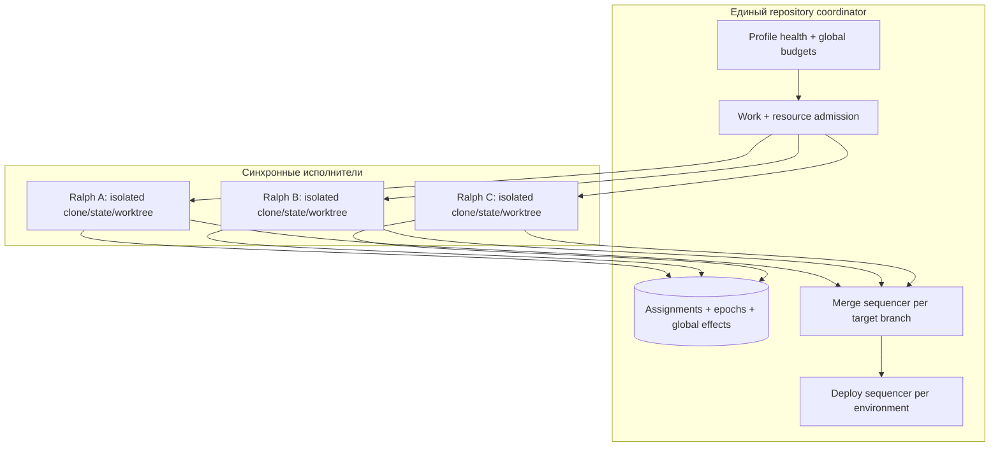

Бр# Архитектурное исследование автономной петли Ralph

> **Снимок на 26.10.2026.** Исследование читало копию ядра внутри SourceCraft-монорепо
> до сведения трёх копий. Пути вида `.claude/ralph/core/…` и номера строк относятся к той
> копии, а не к нынешнему дереву канона. Выводы разложены по плану как риски R1–R15
> (`docs/roadmap/plan.md`); сам документ — история решений, его не правят под код.

**Объект:** копия ядра в SourceCraft-монорепо (`.claude/ralph/`, релиз потребителя)  
**Фокус:** надёжность, восстановление, безопасность и взаимозаменяемость CLI-харнессов  
**Контекст эксплуатации:** один оператор, один VPS, ночные запуски без человека  
**Характер документа:** анализ и выбор архитектуры; реализация не предлагается

## Как читать выводы

- **Факт** — подтверждено исходниками, конфигурацией или локальным воспроизведением. Для важных фактов указаны `path:line`.
- **Предположение** — вероятный эксплуатационный сценарий, частоту или последствия которого нельзя установить по архиву.
- **Предложение** — проектное решение, а не описание существующего поведения.
- **Уверенность** относится к наличию механизма риска, а не к частоте инцидентов. Эксплуатационных рядов данных в архиве нет.

---

# 1. Краткое резюме

## Главный вывод

**Ralph уже содержит зрелый синхронный оркестратор с рядом сильных merge-гарантий. Его следует эволюционировать, а не заменять очередью или durable workflow.** Наиболее ценные свойства — детерминированный гейт точного SHA, `hold` раньше `blocked`, обязательная проверка открытых issues, ограниченная лестница ревью и правок, восстановление после уже выполненного merge — реализованы в коде и покрыты большим набором тестов.

Главная проблема не в синхронности самой по себе. Она в том, что **состояние одной логической попытки распределено между JSON-state, JSONL-намерениями, Git, PR, issues и памятью процесса без общего журнала идентичности попытки и результатов внешних эффектов**. Поэтому отдельные crash-окна имеют разную, местами противоположную семантику: одни пути восстанавливаются fail-closed, другие молча считают внешнюю мутацию выполненной.

Два риска подтверждены не только чтением кода, но и локальными воспроизведениями на боевых функциях с полностью локальными фейками:

1. **После рестарта между снятием `blocked` и вердиктом повторного ревью восстановление метки может фактически не выполниться, но `reReviewPending` всё равно очищается; боевой путь способен дойти до merge.** Причина — fail-open `addBlockedLabel` и отсутствие read-after-write именно на recovery-пути (`.claude/ralph/core/orchestrator.ts:5328–5341`, `.claude/ralph/adapters/github-forge-commands.ts:77–111`).
2. **Если внешний side effect intention фактически выполнен, но адаптер затем сообщил ошибку, сохранённый хвост повторяет тот же request.** В воспроизведении PR-комментарий был опубликован дважды (`.claude/ralph/core/orchestrator.ts:2038–2043`; общий алгоритм — `:1803–2170`).

## Приоритеты

| Приоритет | Решение                                                                 | Почему                                                                                                          |
| --------- | ----------------------------------------------------------------------- | --------------------------------------------------------------------------------------------------------------- |
| P0        | Закрыть fail-open восстановление `blocked` на recovery и arbiter-путях  | Это непосредственно затрагивает доказательство повторного ревью перед merge                                     |
| P0        | Сделать state атомарным и отличать отсутствующий state от повреждённого | Сейчас прямая перезапись и fallback могут стереть последнюю контрольную точку                                   |
| P0        | Ввести явную merge safety policy для CI и повторного ревью              | Отсутствие CI сейчас может означать разрешение merge; допустимость зависит от политики, а не от ответа адаптера |
| P1        | Ввести attempt/intent journal с reconciliation неизвестных исходов      | Устраняет слепые повторы и делает восстановление объяснимым                                                     |
| P1        | Нормализовать исходы CLI в адаптерах через `SessionEndReason`           | Retry/wait/fallback больше не будут зависеть от Claude-специфичных строк                                        |
| P1        | Ввести ролевой router и совместное назначение кодера/ревьюера           | Текущие модельные строки не обеспечивают независимость harness/provider/auth                                    |
| P1        | Сделать security capabilities условием допуска профиля                  | Worktree и Claude hooks не являются переносимой sandbox                                                         |
| P2        | Разделить orchestrator по границам попытки, сдачи и восстановления      | 6991 строка ядра и 11253 строки основного теста повышают цену безопасных изменений                              |

## Рекомендуемая цель

**Для одной петли:** синхронный orchestrator + durable local journal + нормализованные runtime adapters + ролевой router + централизованный merge safety decision. Это не event-driven система и не новый workflow engine. Внешний цикл, Git-хореография, PR-гейт и существующие сценарии сохраняются.

**Для нескольких петель в одном репозитории:** те же синхронные исполнители + **единый координатор владения и глобальный журнал + последовательные merge/deploy на target branch и среду**. Запуск независимых копий Ralph на общем `origin` недопустим как способ масштабирования: текущий lock сознательно защищает только клон запуска и не блокирует другой клон того же репозитория (`.claude/ralph/core/orchestrator.ts:181–186`). Подробный разбор — в разделе 6.5.

Не рекомендуется сейчас:

- внедрять broker событий ради «надёжности»;
- переносить петлю в Temporal-подобный engine без отдельной эксплуатационной необходимости;
- увеличивать число одновременных агентов;
- объявлять Kimi/Codex/Claude взаимозаменяемыми только по успешному запуску CLI;
- считать linked worktree или `bypassPermissions` + hooks достаточной изоляцией.

## Проверка исходного состояния

Локальный изолированный прогон тестов Ralph дал **2151 passed, 0 failed tests в 47 успешно запущенных наборах**. Ещё один набор, `docs-coverage.test.ts`, не запустился, поскольку использует `git ls-files`, а исследуемый архив не содержит `.git`; это ограничение среды анализа, а не дефект Ralph. Два отдельных regression-repro подтвердили описанные выше риски. Их «зелёный» статус означает, что нежелательное поведение воспроизведено, а не что инвариант безопасности выполнен.

---

# 2. Фактическая архитектура и инварианты

## 2.1. Это синхронный stateful orchestrator, а не очередь заданий

**Факт.** Центральный `while (true)` последовательно выбирает фазу, ставит worktree на ветку, читает issues, запускает агентскую сессию, применяет intentions, затем выполняет PR/review/gate/merge/deploy choreography (`.claude/ralph/core/orchestrator.ts:3923–4064`, `:4130–4168`, `:4486–4598`, `:5310–5418`). Дочерние CLI вызываются синхронно; основной путь использует `spawnSync`, а сигнальные handlers намеренно не установлены (`.claude/ralph/core/orchestrator.ts:6746–6752`).

Это даёт простую операционную модель: в каждый момент существует один основной поток решений, а не распределённый набор workers. Цена — длительные блокирующие вызовы и большой модуль, объединяющий runtime policy, recovery, review, merge и deploy.



## 2.2. Фактические состояния распределены, а не представлены одним enum

**Факт.** На диске фаза описывается набором полей `RalphState`: `milestone`, `submitted`, `noProgress`, `gateHeals`, `blockedHeals`, `reReviewPending`, `reviewOfFixes`, `deployBlock`, `forgeHealedRunId` и другими (`.claude/ralph/core/state-lock.ts:34–58`). Дополнительное состояние находится в:

- Git: HEAD, branch refs, чистота worktree, merge status;
- форже: PR, labels `hold`/`blocked`, checks, review comments;
- JSONL: ещё не применённые intentions;
- памяти процесса: `closedThisRun`, `coderTurnRetriesUsed`, `iterationsThisRun` (`.claude/ralph/core/orchestrator.ts:3910–3921`);
- отдельных lock/pid/log/monitor файлах.

Следовательно, **фактическая машина состояний восстанавливается композицией этих источников**, а не читается из единой записи. Это работает для многих сценариев, но именно здесь возникают разночтения после частично выполненных операций.

### Основные переходы

| Из состояния                     | Событие                                     | Действие                                       | Новое состояние / барьер                                |
| -------------------------------- | ------------------------------------------- | ---------------------------------------------- | ------------------------------------------------------- |
| Рабочая очередь непуста          | Выбран issue                                | `state.count++`, запуск coder                  | Coder attempt                                           |
| Coder завершился с любым кодом   | Есть intentions                             | Полная валидация и последовательное применение | Tail сохраняется при ошибке; обработка exit идёт после  |
| Coder failed, дерево чистое      | Не turn-limit stop                          | Продолжить цикл                                | Ограничивается `maxIterations` / `maxNoProgress`        |
| Coder failed, dirty + turn-limit | Есть retry budget                           | Commit leftovers, повтор                       | Ограниченный retry                                      |
| Очередь пуста                    | Открыты blocked/чужие issues                | Не сдавать фазу                                | Stop, C2                                                |
| Очередь пуста                    | PR уже merged                               | Не пересоздавать PR                            | Post-merge recovery / следующая фаза                    |
| PR открыт                        | Нужен review                                | Отдельная review-сессия                        | Clean verdict → `submitted`; findings → fixes           |
| Fix review                       | Blockers / dispute / budget                 | Fix повторно или arbiter                       | Bounded ladder                                          |
| Перед gate                       | `reReviewPending=true`                      | Попытка вернуть `blocked`                      | Сейчас флаг очищается без подтверждения записи — дефект |
| Gate                             | `hold`                                      | Не merge                                       | Human hold сохраняется                                  |
| Gate                             | `blocked`                                   | Bounded blocked heal                           | Повторный review обязателен                             |
| Gate                             | Local checks green + Forge verdict допустим | Squash merge exact head                        | Bounded confirmation                                    |
| Merge confirmed                  | Prod profile                                | Deploy checkpoint и проверка                   | Advance только по политике deploy                       |

## 2.3. Границы ядра, адаптеров и сессий

### Ядро

Ядру принадлежат:

- очередь фаз и issues;
- решения retry/wait/stop/failover;
- Git-хореография и подготовка prompt;
- применение intentions;
- review/fix/arbiter state machine;
- merge policy, heal budgets, deploy lifecycle;
- persistence state и monitor lifecycle.

Это шире, чем «тонкий orchestrator»: `orchestrator.ts` содержит 6991 строку и включает запуск Claude/Kimi/Codex, routing, recovery и composition/testing surface.

### Адаптеры

`RalphAdapters` объявляет `taskSource`, `gate`, `notifier`, `deployCheck`, `coderRuntime` (`.claude/ralph/adapters/adapters.ts:593–599`). Однако степень изоляции различна:

- `taskSource` вынесен на merge path, включая exact-head merge;
- `GateAdapter` объявлен, но основной orchestrator по-прежнему напрямую использует связанный `tryMergePhaseFn` и checks из gate (`.claude/ralph/core/orchestrator.ts:5343–5375`; `.claude/ralph/README.md:84–96`);
- `coderRuntime` фактически является тонким mapper общего запуска; retry и API-limit policy остаются вокруг него;
- reviewer и arbiter используют общий `runClaudeFn`, а не отдельный role-runtime contract.

### Агентские сессии

Сессия не должна напрямую управлять merge. Она изменяет worktree и записывает ограниченные intentions. `session-requests.ts` задаёт закрытый union: `comment`, `close`, `block`, `new-issue`, `pr-comment`, `pr-block`; нет `unhold`, `unblock`, `approve` или `merge`. Это важная положительная граница доверия.

## 2.4. Владение состоянием и побочными эффектами

| Ресурс                   | Владелец записи          | Способ восстановления                              | Основной пробел                                         |
| ------------------------ | ------------------------ | -------------------------------------------------- | ------------------------------------------------------- |
| `state.json`             | Runner                   | Загрузка при старте                                | Неатомарная запись, повреждение принимается за fallback |
| Lock                     | Runner process           | `wx`, stale lock по pid/cmdline                    | Идентичность петли не полностью канонизирована          |
| Worktree / HEAD          | Runner + coder commits   | `ensureClean`, `commitLeftovers`, branch placement | Нет attempt ID, связывающего HEAD с конкретной сессией  |
| PR                       | Runner                   | Найти открытый PR ветки                            | Нет единого submission journal                          |
| `hold`                   | Только человек по смыслу | Gate читает перед `blocked`                        | Сильный инвариант                                       |
| `blocked` на PR          | Runner                   | Повторный цикл / recovery                          | Несколько прямых fail-open записей                      |
| Issues/comments          | Runner по intentions     | Сохранённый tail                                   | Нет idempotency/reconciliation результата               |
| Локально закрытые issues | Память `closedThisRun`   | После restart полагается на tracker                | Возможна лишняя сессия при eventual consistency         |
| Turn retry budget        | Память процесса          | Осознанно сбрасывается restart                     | Стоимость при частых рестартах не известна              |
| Review-of-fixes          | `state.reviewOfFixes`    | Восстановление лестницы                            | Отдельные сильные checkpoints, например `arbitrated`    |
| Deploy                   | `state.deployBlock`      | `pending` сохраняется до ожидания                  | Хороший образец для остальных эффектов                  |

## 2.5. Подтверждённые инварианты доверия

### Merge и Git

1. **Точный SHA.** Gate получает PR head, проверяет SHA40, сверяет локальную ветку, detach'ится на точный SHA и возвращает `lastVerifiedHead` (`.claude/ralph/core/gate.ts:415–560`).
2. **TOCTOU на merge.** GitHub-путь использует `--match-head-commit`; SourceCraft перед POST перечитывает head (`.claude/ralph/adapters/github-forge-commands.ts:150–159`, `.claude/ralph/adapters/sourcecraft-task-source.ts:561–584`).
3. **Human hold первичен.** `hold` проверяется раньше `blocked`; dry-run не доходит до merge (`.claude/ralph/core/gate.ts:768–810`).
4. **Нет зелёных checks — merge не начинается** (`.claude/ralph/core/gate.ts:797–810`).
5. **Merge не считается успешным по одному коду CLI.** Есть bounded `mergeConfirmed`, максимум две попытки и отдельный `merge-unconfirmed` (`.claude/ralph/core/gate.ts:922–987`).

### Завершение фазы и ревью

6. **C2:** пустая рабочая очередь не разрешает сдачу, если в milestone остаются любые открытые issues вне очереди (`.claude/ralph/core/orchestrator.ts:4240–4260`).
7. **Ошибка review не считается разрешением merge** (`.claude/ralph/core/orchestrator.ts:4532–4598`).
8. **После gate heal новый код снова проходит полное review:** `submitted=false`, `reviewOfFixes=null` (`.claude/ralph/core/orchestrator.ts:6162–6178`).
9. **Лестница правок ограничена:** `FIX_REVIEW_MAX_PASSES=3`, disputes=2; исчерпание ведёт к arbiter, а не к бесконечному циклу (`.claude/ralph/core/review-of-fixes.ts:49–54`, `:344–386`).
10. **После вердикта arbiter есть отдельный checkpoint:** `arbitrated` сохраняется только после успешного вызова и intentions (`.claude/ralph/core/orchestrator.ts:5214–5223`).

### Намерения и ограниченность циклов

11. **Сначала валидируется весь intention batch, затем начинаются мутации.** Dry-run не применяет их; при частичном сбое сохраняется неприменённый хвост (`.claude/ralph/core/orchestrator.ts:1803–2170`).
12. **Intentions применяются до классификации ненулевого exit**, поэтому «последняя воля» завершившейся сессии не теряется автоматически (`.claude/ralph/core/orchestrator.ts:4130–4160`).
13. **Конечность задана несколькими независимыми бюджетами:** `maxIterations=10`, `gateHealAttempts=2`, `blockedHealAttempts=3`, `fixReviewAttempts=3`, `apiLimitMaxWaits=3` (`.claude/ralph/ralph.config.json:5–8`, `:94–98`).
14. **Runtime unavailable имеет bounded retry**, а не бесконечное ожидание бинаря (`.claude/ralph/core/runtime-availability.ts:51–56` и политика модуля).

## 2.6. Границы безопасности: что является ими, а что нет



**Факт.** `permissionMode` равен `bypassPermissions` (`.claude/ralph/ralph.config.json:5`). Codex по умолчанию запускается с `danger-full-access` и approvals `never`; Claude hooks не создают автоматически эквивалентный барьер для Codex. `guard.cjs` и `skill-barrier.cjs` зарегистрированы как Claude `PreToolUse` hooks (`.claude/settings.json:81–101`).

**Факт.** `guard.cjs` сам старается быть fail-closed при битом вводе и ошибках правил, но при `bypassPermissions` отказ guard особенно критичен; коды CLI-уровня 1/127 не эквивалентны блокирующему exit 2 (`.claude/hooks/guard.cjs:17–31`, `:127–199`). `skill-barrier.cjs` зависит от Claude transcript и разрешает вызов при отсутствии transcript, чтобы не блокировать человека (`.claude/hooks/skill-barrier.cjs:147–224`).

**Вывод.** Worktree — изоляция рабочих файлов и Git-хореографии, но **не process/filesystem/network sandbox**. Hooks — дополнительный контроль поведения совместимого CLI, но не переносимая граница безопасности.

---

# 3. Найденные расхождения

## 3.1. Документация против кода

| Тема               | Документация / ожидание                                                                                   | Фактический код                                                                                                          | Оценка                                                        |
| ------------------ | --------------------------------------------------------------------------------------------------------- | ------------------------------------------------------------------------------------------------------------------------ | ------------------------------------------------------------- |
| Создание PR        | README описывает создание PR coder-сессией (`.claude/ralph/README.md:122–124`)                            | Runner идемпотентно создаёт/находит PR (`.claude/ralph/core/orchestrator.ts:4486–4519`)                                  | Документация устарела; код лучше отделяет доверенную операцию |
| GateAdapter        | Архитектурный шов подразумевает заменяемость                                                              | Merge path всё ещё связан с `gate.ts`; README это частично признаёт (`.claude/ralph/README.md:84–96`)                    | Не безопасностный дефект, но ограничение переносимости        |
| Runtime adapter    | Комментарий говорит, что Kimi/OpenAI будут добавлены позже (`.claude/ralph/adapters/adapters.ts:524–529`) | Они уже присутствуют в orchestrator и registry                                                                           | Комментарий отстаёт от реализации                             |
| Independent review | Цель — обязательное независимое review                                                                    | Отдельная review-сессия есть, но конфиг допускает `review: none`; router не проверяет harness/provider/auth independence | Целевая гарантия пока не universal                            |
| CI                 | «Зелёный Forge CI» может читаться как обязательный                                                        | `none` через grace даёт `absent`, после которого merge разрешён                                                          | Нужна явная policy required/optional/disabled                 |

## 3.2. Целевая архитектура против текущей

| Целевой контракт                            | Что уже есть                                          | Чего не хватает                                                                                             |
| ------------------------------------------- | ----------------------------------------------------- | ----------------------------------------------------------------------------------------------------------- |
| `SessionEndReason`                          | `code`, `output`, `failureKind`, `systemErrorCode`    | Нейтральные `api-limit`, `turn-limit`, `timeout`, `invalid-output`, `unknown`; нормализация внутри адаптера |
| Профиль = harness + provider + model + auth | Model strings и per-issue provider route              | Именованная auth identity, capabilities, версии, role admission                                             |
| Пулы по ролям                               | Coder route, review model strength, arbiter model     | Reviewer/arbiter/PRD pools и единый role router                                                             |
| Canary на роли                              | Preflight отдельных auth/config условий               | Доказательство поведения профиля на конкретной роли                                                         |
| Совместный выбор кодера и ревьюера          | Отдельные сессии и модельные строки                   | Independence predicate и hold merge при отсутствии независимого reviewer                                    |
| Fallback после checkpoint                   | Некоторые checkpoints уже существуют                  | Единый checkpoint перед сменой маршрута; лимит смен; cooldown/requalification                               |
| Explicit capabilities                       | `maxTurns`, fallback и sandbox различаются фактически | Стартовая проверка совместимости и `turnLimit: best-effort/required`                                        |
| Переносимые skills/hooks/sandbox            | Сильные Claude-specific guards                        | Доказанные отрицательные сценарии для каждого нового harness                                                |

Целевой документ сам точно фиксирует разрыв: `modelRouting` не назначает reviewer/arbiter по роли, а добавление Codex-модели в `review` не переключит harness (`docs/harness-adapters.md:216–222`).

## 3.3. Тесты против реальных crash-окон

**Факт.** Объём регрессионного покрытия велик: только `orchestrator.test.ts` занимает 11253 строки; локально прошли 2151 тест. Есть сценарии false-stop, review-of-fixes, isolation intentions, partial batch и restart.

Но покрытие неравномерно по семантике внешних эффектов:

- В review-of-fixes scenarios `addBlockedLabelFn = vi.fn()` молча «успешен»; проверяется вызов, но не отказ после фактической мутации или полный отказ записи (`.claude/ralph/tests/review-of-fixes-scenarios.test.ts:141`, `:1026–1049`).
- Partial batch tests проверяют сохранение хвоста и его повторный парсинг, но не дубль уже совершённого side effect (`.claude/ralph/core/orchestrator.test.ts:10340–10365`, `:10460–10487`).
- Тесты прямо фиксируют противоречие: intention `pr-block` fail-closed, тогда как `addBlockedLabel` fail-open (`.claude/ralph/core/orchestrator.test.ts:10071–10073`, `:10318–10338`).

**Вывод.** «2151 зелёный тест» подтверждает широкую регрессионную дисциплину, но не доказывает согласованность state/git/PR/issues при всех частичных отказах.

## 3.4. Заявленные и фактические гарантии безопасности

| Заявление, которое можно было бы сделать по названию механизма | Фактическая гарантия                                                                                                                |
| -------------------------------------------------------------- | ----------------------------------------------------------------------------------------------------------------------------------- |
| «Worktree изолирует агента»                                    | Изолирует checkout, но процесс сохраняет доступы хоста и общие Git metadata                                                         |
| «Hooks запрещают опасные действия»                             | Для Claude-compatible пути есть содержательные guards; это не доказано для Codex/native harness                                     |
| «Секреты удалены из env — PR-код безопасен»                    | Gate действительно санитизирует env checks/npm ci, но выполняет код и зависимости PR; файловая и сетевая изоляция этим не создаётся |
| «Reviewer независим, потому что другая модель»                 | Отдельный контекст сессии — да; независимость provider/auth/harness — не доказана                                                   |
| «CI green»                                                     | Green проверяется, но absent также может привести к merge; missing timestamp отключает freshness verdict                            |
| «Все повторы конечны»                                          | Основные бюджеты конечны; стоимость при внешних рестартах и сбросе in-memory budgets зависит от эксплуатации                        |

---

# 4. Ранжированные риски

## Метод ранжирования

Приоритет учитывает прежде всего возможность нарушить merge-инвариант, затем необратимость внешнего эффекта, стоимость ночного восстановления и вероятность распространения на новые harness. Оценка не является измеренной частотой: таких данных нет.

| ID  | Приоритет                          | Риск                                                            | Последствие                                                                          | Уверенность в механизме                                      |
| --- | ---------------------------------- | --------------------------------------------------------------- | ------------------------------------------------------------------------------------ | ------------------------------------------------------------ |
| R1  | P0                                 | Fail-open восстановление `blocked`                              | Merge после незавершённого повторного review                                         | Высокая: код + repro                                         |
| R2  | P0                                 | Неатомарный state и fallback при повреждении                    | Потеря checkpoints, повтор работы, неверная фаза                                     | Высокая: код                                                 |
| R3  | P0/P1                              | Выполнение кода проверяемого PR и широкие права агентов         | Компрометация раннера, Git metadata или доступных секретов                           | Высокая в механизме; вероятность зависит от доверия к входам |
| R4  | P1                                 | Неидемпотентные intentions при неизвестном исходе               | Дубли комментариев/issues/мутаций, рассинхронизация                                  | Высокая: код + repro                                         |
| R5  | P1                                 | Независимость ролей не выражена структурно                      | Самопроверка или общий failure domain выдаются за independent review                 | Высокая относительно цели                                    |
| R6  | P1, условно P0                     | Отсутствие CI и отсутствие timestamp могут ослабить verdict     | Merge без обязательного внешнего CI или без freshness                                | Высокая в коде; критичность зависит от policy                |
| R7  | P1                                 | Классификация CLI по тексту и неполный нейтральный результат    | Ложный retry/wait/stop, неправильный failover, стоимость                             | Высокая                                                      |
| R8  | P1                                 | Переносимые guards/skills/sandbox не доказаны для новых harness | Профиль запускается без ожидаемых ограничений                                        | Высокая                                                      |
| R9  | P2                                 | In-memory компенсации и retry budgets                           | Лишние сессии и повторные расходы после restart                                      | Высокая в механизме; частота неизвестна                      |
| R10 | P2                                 | Fail-open диагностики прогресса и comments                      | Ложное «есть прогресс», потеря контекста ревью                                       | Высокая                                                      |
| R11 | P2                                 | Наблюдаемость best-effort и частично слепая                     | Позднее обнаружение остановки, неполные метрики                                      | Высокая                                                      |
| R12 | P2                                 | Рост orchestrator и неоднородный DI                             | Ошибки при изменении критических путей                                               | Высокая как maintainability risk                             |
| R13 | P2                                 | Версии и capabilities CLI не образуют единого допуска           | Обновление CLI молча меняет поведение ночной петли                                   | Высокая относительно цели                                    |
| R14 | P3, условно                        | Идентичность lock для нескольких петель                         | Конфликт или ошибочное освобождение при неоднозначном пути                           | Средняя; зависит от запуска                                  |
| R15 | P0 при включении нескольких петель | Нет глобального ownership, fencing и merge/deploy serialization | Двойная работа, гонки refs/PR, устаревшее merge evidence, конфликт deploy и бюджетов | Высокая: прямые контракты кода; частота не измерена          |

## R1 — P0: восстановление `blocked` не подтверждает запись

**Факт и сценарий отказа.**

1. Runner снимает `blocked` перед повторным review и сохраняет `reReviewPending=true`.
2. Процесс умирает до вердикта.
3. После restart orchestrator вызывает `addBlockedLabelFn`, затем безусловно делает `reReviewPending=false` и сохраняет state (`.claude/ralph/core/orchestrator.ts:5328–5341`).
4. GitHub-реализация ловит ошибку установки label и не возвращает результат (`.claude/ralph/adapters/github-forge-commands.ts:77–111`); SourceCraft-методы также обёрнуты в `quiet` (`.claude/ralph/adapters/sourcecraft-task-source.ts:598–604`).
5. Если форж не вернул label, gate уже не увидит `blocked`. При остальных зелёных условиях возможен merge без завершённого повторного review.

Тот же класс присутствует на путях arbiter: прямые `addBlockedLabelFn` не имеют read-after-write (`.claude/ralph/core/orchestrator.ts:5157–5181`, `:5186–5212`, `:5224–5239`).

**Последствие.** Нарушается не человеческий `hold`, а автоматический барьер «повторное review обязано завершиться». Это особенно опасно ночью: внешне фаза выглядит успешно восстановленной.

**Воспроизведение.** Локальный сценарий на боевом `runLoop`: состояние `reReviewPending=true`, `addBlockedLabelFn` ничего не меняет, остальные форж/git/gate-фейки моделируют зелёный путь. Наблюдение: `reReviewPending` очищен, результат — `merged`. Два теста repro прошли, подтвердив фактическое поведение.

**Почему существующие тесты не поймали.** В сценариях arbiter используется `vi.fn()` без отказа записи; проверяется сам вызов (`.claude/ralph/tests/review-of-fixes-scenarios.test.ts:141`, `:1026–1049`).

**Уверенность:** высокая.

**Предложение.** Для safety-critical label recovery результат должен быть fail-closed и подтверждаться перечитыванием PR. `reReviewPending` нельзя очищать, пока не доказано одно из двух: либо `blocked` восстановлен, либо повторный review завершён и его checkpoint сохранён. Неизвестный исход записи должен удерживать merge.

## R2 — P0: state persistence не атомарен, повреждение неотличимо от отсутствия

**Факт.** `saveState` напрямую вызывает `writeFileSync(statePath, ...)`, без временного файла и rename (`.claude/ralph/core/state-lock.ts:153–162`). `loadJson` возвращает fallback при любой ошибке чтения или парсинга (`.claude/ralph/core/exec.ts:48–54`), а `loadState` не выполняет полной schema validation (`.claude/ralph/core/state-lock.ts:141–150`).

**Сценарий отказа.** VPS или процесс останавливается во время перезаписи; файл оказывается пустым или содержит неполный JSON. Следующий запуск принимает fallback как исходное состояние. Могут потеряться `submitted`, `reReviewPending`, `reviewOfFixes`, heal budgets и deploy checkpoint.

**Последствие.** Повторные сессии и расходы — наименьший вариант. Худший зависит от внешних компенсаций: Git/PR/issues часто позволят восстановиться, но не обязаны восстановить точный смысл прерванного review или deploy. Нельзя утверждать, что каждое повреждение приведёт к небезопасному merge; можно утверждать, что последняя локальная контрольная точка перестаёт быть надёжной.

**Воспроизведение.** На копии state обрезать JSON после непустой записи и выполнить обычный load; отличить этот случай от отсутствующего файла по результату невозможно. Для отчёта достаточно статического доказательства; боевой файл не изменялся.

**Уверенность:** высокая в механизме, частота неизвестна.

**Предложение.** Атомарная запись, проверка схемы и версии, явный `corrupt` вместо fallback, сохранение повреждённого файла для диагностики. Это должно предшествовать расширению state новыми маршрутами и бюджетами.

## R3 — P0/P1: агент и gate исполняют недоверенный код вне полной sandbox

### 3A. Кодер-сессия

**Факт.** Claude работает с `bypassPermissions`; Codex по умолчанию — `danger-full-access`, approvals `never` (`.claude/ralph/ralph.config.json:5`; Codex argv в `.claude/ralph/core/orchestrator.ts:1243–1280`). Worktree не ограничивает процесс хоста. Целевой документ прямо указывает, что общие Git metadata linked worktree остаются доступны (`docs/harness-adapters.md:320–355`).

**Сценарий.** Prompt injection в issue/PR comments или вредоносный diff побуждает агента читать файлы вне worktree, изменять общие refs/config или использовать сеть. Ограничения prompt и hooks снижают вероятность для совместимого CLI, но не образуют границу ОС.

### 3B. Gate

**Факт.** Gate запускает `npm ci` и checks из дерева проверяемого PR. Код санитизирует env, но прямо признаёт выполнение PR-кода (`.claude/ralph/core/gate.ts:511–560`, особенно `:520–537`). Проект уже внёс это в открытые риски: PR может изменить сам gate policy или подложить `.npmrc` (`.claude/ralph/CLAUDE.md:453–455`).

**Сценарий.** PR изменяет скрипт check, lifecycle dependency или gate policy. Даже без GH/TG секретов в env процесс может иметь файловый и сетевой доступ в рамках запускающего контейнера/пользователя. Если gate policy берётся из того же PR, проверяемый код способен влиять на критерий собственной проверки.

**Последствие.** От ложного green до компрометации Git metadata и доступных ресурсов VPS. Реальная тяжесть зависит от того, кто может создавать issues/PR и насколько входы считаются доверенными.

**Воспроизведение.** Безопасный негативный canary: тестовый check пытается записать вне worktree, прочитать `git rev-parse --git-common-dir`, открыть сетевое соединение и обнаружить разрешённые env. Не нужен реальный вредоносный payload.

**Уверенность:** высокая в отсутствии полной изоляции; эксплуатационная вероятность не установлена.

**Предложение.** Разделить две политики: доверенные Git metadata и изолированный клон. Gate policy должна происходить из доверенной базовой ревизии, а проверяемый код — выполняться в отдельном sandbox profile с allowlist env, ограничениями CPU/PID/memory/time и явной сетевой политикой. До этого не называть worktree security boundary.

## R4 — P1: повтор intention может дублировать внешний эффект

**Факт.** Batch сначала валидируется целиком, затем requests применяются последовательно. При ошибке на индексе `i` сохраняется `requests.slice(i)` (`.claude/ralph/core/orchestrator.ts:1803–2170`). Комментарий прямо признаёт, что side effect мог уже произойти до ошибки (`:2038–2043`). В `session-requests.ts` нет устойчивого intent ID, attempt ID, idempotency key или per-intent result journal.

**Сценарий.** Форж принял PR-комментарий, но ответ оборвался. Адаптер бросил ошибку; request остался в tail. Следующий запуск публикует его повторно.

**Последствие.** Дубли комментариев и issues, повторные close/block, ложная картина активности, дополнительные review notifications. Для `pr-block` последствие безопаснее благодаря read-back, но общий канал не даёт единой семантики unknown outcome.

**Воспроизведение.** Локальный fake adapter выполняет запись, затем бросает один раз. Наблюдаемая последовательность публикаций: `['первый', 'повторяемый', 'повторяемый']`.

**Уверенность:** высокая.

**Предложение.** Не обещать exactly-once на внешнем API. Журналировать `prepared → attempting → confirmed/unknown`, присваивать стабильный intent ID и перед повтором выполнять reconciliation там, где форж позволяет найти эффект. Для необратимых или неразличимых эффектов неизвестный исход требует консервативной остановки, а не слепого retry.

## R5 — P1: ролевая независимость пока не доказана

**Факт.** Текущий конфиг направляет coder на `claude-opus-5-5`; reviewer default/escalated/fallback также используют `claude-opus-5-5`, arbiter — `claude-fable-5` (`.claude/ralph/ralph.config.json:104–132`). `pickReviewModel` и fallback выбирают модельные строки, `assertKnownReviewModels` проверяет strength, но не harness/provider/auth (`.claude/ralph/core/review.ts:129–226`, `:315–361`). Reviewer/arbiter вызываются через общий runtime.

**Сценарий.** Кодер и reviewer используют один harness, provider, auth и модель; общий CLI defect или одинаковая системная ошибка влияет на оба. После failover кодера reviewer может оказаться тем же контуром, который продолжил код.

**Последствие.** Отдельная сессия всё ещё снижает контекстную предвзятость — это полезная существующая гарантия. Но она не эквивалентна целевой независимости и не должна засчитываться как независимый резерв при отказе всего provider/harness.

**Воспроизведение.** Конфигурационный тест: назначить одинаковые profile identities кодеру и reviewer; текущая валидация model strength не имеет основания отклонить такую пару.

**Уверенность:** высокая относительно целевой архитектуры.

**Предложение.** Joint assignment и явный independence predicate. Если независимый reviewer недоступен — merge hold. Не компенсировать отсутствие независимости большим числом повторных reviews того же профиля.

## R6 — P1, условно P0: внешний CI имеет неоднозначную политику отсутствия

**Факт.** Если checks отсутствуют дольше `absentGraceMs`, возвращается `absent` с сообщением «мерджим без ожидания» (`.claude/ralph/core/forge-checks.ts:296–301`); gate разрешает продолжение для этого исхода (`.claude/ralph/core/gate.ts:896–898`). По умолчанию grace — две минуты. Кроме того, `createdAt` необязателен, а `isStale` не считает run устаревшим без обеих дат (`.claude/ralph/core/forge-checks.ts:110–141`). При ошибке получения `headCommittedAt` freshness в текущем круге не проверяется (`.claude/ralph/core/gate.ts:609–615`, `:831–839`).

**Сценарий.** CI обязателен, но workflow не завёлся, адаптер не увидел runs или ответ не содержит дату. Ralph принимает absent/непроверенную freshness как неблокирующее состояние.

**Последствие.** Если branch protection действительно требует checks, форж может всё равно отклонить merge; тогда это лишнее ожидание/ложная попытка, а не bypass. Если защита не обязательна или настроена иначе, возможен merge без ожидаемого внешнего CI.

**Воспроизведение.** Unit-сценарий `checks.state='none'` дольше grace; затем gate outcome `absent`. Для freshness — run без `createdAt` и ненулевой `sinceMs`.

**Уверенность:** высокая в поведении; критичность условна.

**Предложение.** Явная конфигурация `forgeChecks: required | optional | disabled`. `required`: absent, unknown timestamp и недоступность freshness не дают merge. `optional`: absent допустим, но зелёный старый run — нет. `disabled`: адаптер не вызывается. Решение должно быть видно в merge evidence.

## R7 — P1: политика повторов зависит от диагностического текста

**Факт.** Текущий `RunResult` содержит `code`, `output` и spawn classification, но не `SessionEndReason` (`.claude/ralph/adapters/adapters.ts:563–577`). Оркестратор сканирует `output` через `API_LIMIT_RE` и `TURN_LIMIT_RE`; turn retries запускаются только при regex (`.claude/ralph/core/api-limit.ts:20–28`, `.claude/ralph/core/orchestrator.ts:4435–4461`). RUNBOOK признаёт, что Claude markers не покрывают лимиты Kimi/Codex, а Codex не имеет эквивалентов некоторых Claude flags (`.claude/ralph/RUNBOOK.md:204–309`).

**Сценарий.** Провайдер меняет текст ошибки; CLI возвращает structured error; сообщение похоже на limit в обычном выводе. Ядро выбирает неверный wait/retry/stop. При fallback второй provider может вернуть собственный лимит, который не нормализован как таковой.

**Последствие.** Ложная остановка, лишнее ожидание, повторная стоимость или неправильный выбор failover. Это не доказывает автоматический unsafe merge: merge gates остаются отдельным барьером.

**Воспроизведение.** Contract tests каждого адаптера на одинаковые semantic outcomes: process start failure, quota, max turns, timeout, malformed output, ordinary code failure, unknown.

**Уверенность:** высокая.

**Предложение.** Перенести распознавание в adapter; ядро принимает решения только по нейтральному `SessionEndReason`. `output` оставить диагностикой, а не каналом управления.

## R8 — P1: hooks и skills не переносятся автоматически

**Факт.** `skill-barrier` разбирает конкретный Claude JSONL transcript, session id и `Skill` events (`.claude/hooks/skill-barrier.cjs:147–224`). Codex запускается отдельным CLI и не наследует Claude `PreToolUse` registration. Целевой документ требует negative canary и preflight полного набора plugins/config (`docs/harness-adapters.md:258–269`, `:304–318`).

**Сценарий.** Новый профиль успешно читает skills и выполняет обычную карточку, поэтому объявляется допущенным. Но запрещённая команда не блокируется, потому что событие hook не зарегистрировано или transcript имеет другой формат.

**Последствие.** Молчаливое снижение защиты именно при failover — в момент, когда основной контур уже нестабилен.

**Уверенность:** высокая.

**Предложение.** Role canary обязан включать запрещённое действие с доказанной остановкой. Успешный happy path недостаточен. Если harness не обеспечивает требуемый барьер, профиль либо не допускается, либо получает явно более строгий внешний sandbox.

## R9 — P2: restart сбрасывает часть компенсаций и бюджетов

**Факт.** `closedThisRun` и `coderTurnRetriesUsed` живут только в памяти (`.claude/ralph/core/orchestrator.ts:3914–3921`). Комментарий называет сброс turn budget после ручного restart осознанным. `closedThisRun` нужен из-за eventual consistency tracker (`.claude/ralph/core/orchestrator.ts:4050–4058`).

**Сценарий.** Issue закрыт, tracker ещё отдаёт его открытым, процесс перезапущен. Локальный фильтр потерян, и новая сессия берёт уже сделанную работу. При повторных restart turn-limit retry budget также начинается заново.

**Последствие.** Лишние токены и время; возможны повторные commits/intentions. Основной `maxIterations` и persisted heal budgets ограничивают обычный непрерывный run, но не дают глобального бюджета на серию внешних перезапусков.

**Уверенность:** высокая в механизме, стоимость неизвестна.

**Предложение.** Сохранять attempt identity и последние подтверждённые эффекты. Не делать каждый transient счётчик вечным: нужны окна TTL и явная политика operator reset.

## R10 — P2: отдельные fail-open решения уменьшают качество диагностики

**Факт.** Ошибка чтения HEAD/issues при проверке прогресса оставляет `progressed=true` (`.claude/ralph/core/orchestrator.ts:4197–4209`). Ошибка чтения trusted PR comments приводит к prompt без comments (`.claude/ralph/core/orchestrator.ts:4376–4390`). Log write best-effort (`.claude/ralph/core/exec.ts:83–90`).

**Сценарий.** Сетевой сбой скрывает отсутствие прогресса; другой сбой удаляет замечания из контекста исправления. Петля продолжает работать, но решение принимается на неполных данных.

**Последствие.** Дополнительные итерации, ложное «прогресс есть», повторные findings. `maxIterations` сохраняет конечность обычного цикла, поэтому это не доказательство бесконечного цикла.

**Предложение.** Различать safety decision и liveness decision. Для merge/review completeness — fail-closed; для диагностического breaker допустим fail-open, но со счётчиком consecutive unknown и отдельным stop по неопределённости.

## R11 — P2: наблюдаемость не образует полного audit trail

**Факт.** `log()` подавляет ошибку append (`.claude/ralph/core/exec.ts:83–90`). RUNBOOK фиксирует частичную слепоту SourceCraft monitor из-за `gh` и отсутствие автоматической ротации session logs (`.claude/ralph/RUNBOOK.md:154–166`, `:568–596`).

**Сценарий.** Диск заполнен или лог недоступен; консоль ушла в журнал сервиса, а файл deadman перестал обновляться. Либо counters не видят SourceCraft-specific события. После инцидента невозможно восстановить точную последовательность attempt/effect/review/gate.

**Последствие.** Ложный DEADMAN или поздняя диагностика; невозможность измерить стоимость self-heal и MTTR.

**Предложение.** Структурный журнал событий отдельно от человеко-читаемого лога; ротация и disk watermark; heartbeat не должен зависеть только от успешности одного append.

## R12 — P2: orchestrator стал центром слишком многих политик

**Факт.** `orchestrator.ts` — 6991 строка, его основной test file — 11253 строки. Публичный composition/testing surface занимает `.claude/ralph/core/orchestrator.ts:6818–6990`. В preflight defaults части collaborators читают фабричный `config`, а не только resolved config (`:3393–3397`).

**Сценарий.** Изменение runtime fallback нечаянно затрагивает review recovery; тест подменяет один seam, но production default берёт другой. Большое число тестов снижает, но не устраняет риск.

**Последствие.** Рост стоимости review и вероятности расхождения тестового и боевого composition.

**Предложение.** Делить по существующим семантическим границам: attempt execution, intention application, submission/review, merge recovery, deploy. Не дробить ради количества файлов и не менять поведение одновременно с извлечением.

## R13 — P2: отсутствует единый допуск версии/capabilities CLI

**Факт.** Отдельные auth/config preflight checks есть, но целевая таблица executable/version/auth/end-reasons/turn-limit/fallback/skills/hooks/sandbox ещё не реализована как единый role admission (`docs/harness-adapters.md:282–318`). Kimi использует Claude-compatible CLI, Codex — другой набор flags.

**Сценарий.** Ночное автообновление меняет output, config discovery или hook event. Бинарь существует и auth проходит, но поведение контракта изменилось.

**Последствие.** Отказ только на реальной карточке; неверный fallback; потеря max-turn или guard semantics.

**Предложение.** Версия и capabilities — часть profile qualification, с журналом фактической версии на каждом attempt. Несовместимость обнаруживается до выбора issue.

## R14 — P3, условно: lock identity не канонизирована для нескольких петель

**Факт.** Lock acquisition использует атомарный `wx`, stale lock проверяет pid/cmdline, release — только свой pid; это сильная база (`.claude/ralph/core/state-lock.ts:274–459`). Но относительный `RALPH_PATH` сам по себе не даёт уникальной identity нескольких петель (`:249–253`).

**Сценарий.** Одна логическая петля запускается через разные относительные пути или копии дерева с общими внешними ресурсами.

**Последствие.** Два runner могут считать себя разными, изменяя одни PR/issues. Конкретная эксплуатируемость зависит от systemd/launch configuration, которого в полном виде нет.

**Предложение.** Канонические `repo_id` и уникальный `loop_id` в явном namespace; profile не должен служить identity петли, поскольку одинаковые профили допустимы у разных loops. Блокировать не только процесс, но и внешний scope.

## R15 — P0 при включении нескольких петель: локальный lock не координирует общий репозиторий

**Факт.** Текущий lock атомарен и корректно защищает от двойного запуска на одном состоянии дерева запуска (`.claude/ralph/core/state-lock.ts:274–290`, `:338–459`). Но его область действия прямо ограничена клоном: другой клон того же `origin` не блокируется, хотя PR, merge и ветки общие (`.claude/ralph/core/orchestrator.ts:181–186`). Состояние фазы — один указатель `milestone`, а `advancePhase` последовательно переводит его к следующему элементу конфига (`:3332–3376`). Выбор работы начинается с общей очереди без claim (`:4050–4064`).

**Сценарий отказа.** Два runner из разных клонов читают один milestone и issue, создают attempts, пишут в одни внешние ресурсы и независимо расходуют budgets. Если фазы разные, обе всё равно могут получить green на старом общем base и одновременно пройти к merge/deploy. Если одна зависла, другая не имеет формального способа отличить живого владельца от orphaned work.

**Последствие.** Дубли работы и effects, non-FF/divergence, противоречивые review state, закрытие/переход фазы при активной работе другой петли, умножение стоимости и потеря доказательства, какая комбинация кода проверена. Для prod локальный `deployBlock` одной петли не останавливает merge другой.

**Предлагаемое воспроизведение (в этом исследовании не выполнялось).** На двух изолированных клонах одного локального bare remote запустить два runner с разными state/worktree и общим fake forge. Оба старта пройдут локальный lock; конкурентный сценарий затем моделирует одинаковый первый issue и смену target main между gate двух кандидатов. Боевые VPS/API для доказательства не нужны.

**Уверенность:** высокая в отсутствии глобальной координации; конкретный исход каждой гонки зависит от remote/branch protection и таймингов.

**Предложение.** До разрешения второй петли в общем репозитории ввести глобальный ownership registry, epoch fencing, coordinator-authorized mutations, общий completion barrier и merge/deploy sequencer. Подробная модель и варианты — разделы 6.5 и 7.10–7.14.

---

# 5. Неочевидные находки

## 5.1. Самый сильный и самый слабый `blocked`-пути находятся рядом

Intent `pr-block` перечитывает PR и проверяет label — fail-closed (`.claude/ralph/core/orchestrator.ts:2091–2106`). Recovery перед gate вызывает fail-open primitive и очищает flag (`:5328–5341`). Таким образом, проблема не в невозможности verify-after-write на текущем форже: нужный паттерн уже существует в том же модуле, но применён не ко всем safety-critical путям.

## 5.2. «Применить intentions до разбора crash» — правильный выбор, который усиливает необходимость журнала

Если сессия успела записать `block` или `close` перед max-turn, ранняя обработка intentions сохраняет смысл работы (`.claude/ralph/core/orchestrator.ts:4144–4160`). Откладывать intentions до успешного exit было бы хуже. Поэтому решение R4 — не менять порядок, а сделать результат каждого effect восстановимым.

## 5.3. В проекте уже есть образцы хороших checkpoints

- `submitted` после рестарта направляет сразу к gate, минуя повторное создание submission (`.claude/ralph/core/orchestrator.ts:4471–4475`).
- `arbitrated` сохраняется только после verdict и intentions (`:5214–5223`).
- `deployBlock: pending` записывается до долгого ожидания (`:5418–5560`).
- После merge recovery сначала проверяет фактический merged status (`:4263–4324`).

Это аргумент за эволюцию: команда уже использует нужные приёмы, но они не объединены общим attempt/effect protocol.

## 5.4. Не всякий fail-open вреден

Notifier fail-open не должен останавливать петлю; отсутствие deploy для проекта без deploy не должно блокировать каждую фазу; `closedThisRun` компенсирует eventual consistency. Ошибка — не сам выбор fail-open, а **отсутствие явной классификации, где fail-open допустим**. Для уведомления он допустим, для доказательства review/CI/label перед merge — нет.

## 5.5. Kimi и Claude частично разделяют failure domain

Kimi запускается через Claude CLI с Moonshot env. Это даёт совместимость `--max-turns`, hooks и skills, но общий CLI defect, argv behavior или transcript change влияет на оба профиля. Codex — действительно другой harness, но с другим набором гарантий. Поэтому «три провайдера» не равно «три независимых контура».

## 5.6. Codex `maxTurns` не нужно имитировать

Отсутствие точного аналога `--max-turns` не делает Codex непригодным. Внешние `maxIterations`, timeout и другие budgets продолжают ограничивать петлю. Честный `best-effort` лучше ложного `required`; целевой документ уже формулирует это правильно (`docs/harness-adapters.md:211–214`, `:288–302`).

## 5.7. Gate выполняет не только код продукта, но и код собственной проверки

Изменения `.claude/ralph/**` попадают в escalated paths (`.claude/ralph/ralph.config.json:126–130`), что полезно. Но если сам gate config/policy берётся из проверяемого дерева, усиленное review не заменяет доверенную неизменяемую policy. Это отдельная trust-root проблема, а не просто «опасные тесты».

## 5.8. Circuit breakers конечны, но стоимость self-heal нельзя вывести из конфигурации

`maxIterations=10`, heal и review budgets задают потолки внутри обычного запуска. Однако фактическая цена зависит от длительности сессий, fallback waits, внешних restarts, повторных effects и количества фаз. В архиве нет рядов стоимости/длительности, поэтому утверждения вида «ночная петля тратит X» были бы выдумкой.

## 5.9. Прогресс по HEAD может конфликтовать с качеством прогресса

WIP commit двигает HEAD и сбрасывает `noProgress`, даже если issue не приблизился к закрытию. Отдельный turn retry budget частично компенсирует это (`.claude/ralph/core/orchestrator.ts:4182–4193`), но сама метрика «HEAD изменился» измеряет активность, а не полезный результат. Для наблюдаемости нужны отдельно commits, закрытые issues, review findings и time-to-green.

## 5.10. Синхронность не является источником найденных P0

R1 возникает из-за неподтверждённого effect, R2 — из-за persistence, R4 — из-за unknown outcome. Event queue или durable engine сами по себе не исправят ни одно: без read-after-write, атомарного state и reconciliation те же окна сохранятся, только в другой инфраструктуре.

---

# 6. Сравнение архитектурных вариантов

## Общие критерии

Оцениваются не модность и не теоретическая масштабируемость, а пригодность для одного оператора на одном VPS: восстановление после kill/reboot, сохранение merge-инвариантов, цена эксплуатации, тестируемость, наблюдаемость и миграция без остановки текущей петли.

| Критерий                      | A. Эволюция синхронного orchestrator                   | B. События / очередь                                      | C. Durable workflow engine                                             |
| ----------------------------- | ------------------------------------------------------ | --------------------------------------------------------- | ---------------------------------------------------------------------- |
| Основная модель               | Текущий цикл + durable local state/journal             | Команды и события через broker, workers                   | Реиграбельный workflow, durable timers/tasks                           |
| Соответствие текущей нагрузке | Высокое: одна последовательная петля                   | Избыточно при одном потоке решений                        | Избыточно без независимых workflows                                    |
| Восстановление                | Хорошее после attempt/effect journal                   | Хорошее при дисциплине consumer/outbox                    | Сильное для control flow, но внешние effects всё равно требуют журнала |
| Идемпотентность PR/issues     | Нужно спроектировать                                   | Не появляется автоматически                               | Не появляется автоматически                                            |
| Merge fail-closed             | Сохраняется на текущем пути                            | Легко размыть между consumers                             | Сохраняется только при явном переносе политики                         |
| Операция одним человеком      | Минимальные новые компоненты                           | Broker, retention, DLQ, consumer lag, upgrades            | Engine, DB, worker lifecycle, versioning, replay diagnostics           |
| Восстановление VPS            | Локальный журнал + существующие checks                 | Broker и consumers должны восстановиться согласованно     | Engine DB становится критическим state                                 |
| Тестируемость                 | Сохраняются DI и 2151 тест; добавляются crash matrices | Нужны event ordering, duplicates, DLQ tests               | Нужны replay determinism и workflow versioning tests                   |
| Наблюдаемость                 | Attempt timeline непосредственно полезен               | Хорошие метрики очереди, но distributed trace сложнее     | Сильный workflow history, сложнее сопоставление с Git/PR               |
| Цена миграции                 | Низкая/средняя, поэтапная                              | Высокая: разрезать orchestrator и протоколы               | Наиболее высокая                                                       |
| Риск утратить гарантии        | Низкий при strangler migration                         | Средний/высокий                                           | Высокий при полном переносе                                            |
| Когда станет оправдан         | Уже сейчас                                             | Несколько независимых loops/workers, реальная конкуренция | Много долгих workflows, таймеров и сложной координации                 |

## Вариант A — эволюция синхронного orchestrator

**Содержание:** оставить последовательный run loop; добавить атомарный versioned state, attempt/effect journal, нормализованный runtime result, role router и централизованный merge evidence.

**Преимущества:**

- адресует фактические P0 напрямую;
- сохраняет существующие Git/PR/recovery сценарии;
- можно вводить небольшими вехами с regression tests;
- не появляется новый сетевой сервис или broker;
- один оператор видит единую временную шкалу фазы.

**Ограничения:**

- длительный синхронный процесс остаётся;
- orchestrator нужно сознательно уменьшать по ответственности;
- локальный журнал требует backup/rotation и схемы восстановления;
- это не даёт параллелизма «из коробки» — но параллелизм и не является поставленной целью.

**Вывод:** лучший вариант для текущего контекста.

## Вариант B — события и очередь

**Содержание:** intentions, session results, review requests, gate jobs и deploy checks становятся сообщениями; отдельные consumers обрабатывают их.

**Что реально улучшилось бы:** разделение долгих ожиданий, независимый restart consumers, естественная retries/DLQ модель, несколько параллельных loops в будущем.

**Почему сейчас хуже:**

- внешняя доставка остаётся at-least-once; R4 не исчезает;
- появляются ordering между state/git/PR и событиями;
- нужно гарантировать, что два consumers не выполняют merge/review одновременно;
- человеческий `hold` и exact-SHA evidence придётся переносить через несколько сообщений;
- оператор получает broker, DLQ и новые ночные failure modes раньше, чем новую необходимую гарантию.

**Вывод:** не выбирать сейчас. Внутренний append-only journal полезен, но он не требует публичного broker и event-driven переписывания.

## Вариант C — durable workflow engine

**Содержание:** фаза становится durable workflow; сессии и форж-операции — activities; ожидания API/CI/deploy — durable timers.

**Что реально улучшилось бы:** восстановление control flow, timers без ручных sleep loops, история шагов, versioning долгих процессов.

**Почему сейчас хуже:**

- двухчасовые CLI и Git/worktree остаются внешними side effects;
- kill activity не доказывает, что процесс/HTTP mutation не завершился;
- replay требует детерминизма, который текущий orchestrator ещё не отделил от I/O;
- merge safety policy всё равно придётся проектировать заново;
- миграция сопряжена с наибольшим риском потерять неявные, уже работающие компенсации.

**Вывод:** рассматривать повторно только после появления измеренной потребности: несколько долгоживущих loops, большое число независимых ожиданий, несколько операторов/workers или невозможность поддержать recovery локальным журналом.

## Итог выбора

**A — рекомендуемый вариант для одной петли и для внутреннего устройства каждого worker.** B и C могут быть будущими направлениями, но сегодня их инфраструктурная цена покупает не те гарантии, которые реально отсутствуют. Главный переход — не «sync → async», а **«разрозненные checkpoints → явная durable семантика попыток и эффектов»**.

**Для нескольких петель в общем репозитории вариант A обязательно дополняется глобальным coordinator.** При независимых репозиториях достаточно общего resource/budget control. При общем `origin` минимально нужен M1: статическое владение + merge/deploy sequencer. Динамические assignments требуют M2 с enforced fencing. Выбор B/C сам по себе не создаёт ни ownership, ни base freshness, ни global C2.

## 6.5. Масштабирование на несколько петель: отдельный архитектурный режим

### 6.5.1. Почему `N` копий не дают `N` независимых петель

**Факт.** Текущая безопасность опирается не только на файлы и locks, но и на неявное допущение: существует один последовательный владелец фазы и merge path. В коде это видно по единому `state.milestone`, последовательному `advancePhase`, первому issue из очереди и локальным in-memory компенсациям (`.claude/ralph/core/orchestrator.ts:3332–3376`, `:3914–3921`, `:4050–4064`).

Lock от двойного запуска при этом хорош именно для своей задачи: `wx` закрывает гонку одновременного захвата, stale lock разбирается по pid/cmdline, чужой lock не снимается (`.claude/ralph/core/state-lock.ts:274–335`, `:338–459`). Но область lock — дерево запуска. Исходник прямо указывает, что runner из другого клона того же `origin` не блокируется, хотя гонка за PR/merge/ветки остаётся общей (`.claude/ralph/core/orchestrator.ts:181–186`).

**Вывод.** Нельзя считать текущий lock ни ошибочным, ни достаточным для многопетлёвости. Он корректный **process lock**, но не **repository-wide coordination protocol**.

### 6.5.2. Уровни изоляции, которые нужно различать

| Уровень     | Что разделяется                   | Что всё ещё может быть общим               | Достаточно ли для двух петель                |
| ----------- | --------------------------------- | ------------------------------------------ | -------------------------------------------- |
| Процесс     | pid, память, retry maps           | state, worktree, remote                    | Нет                                          |
| Worktree    | checkout, HEAD, node_modules      | `.git` common dir, refs, remote, PR        | Нет                                          |
| Клон        | Локальные `.git`, refs и worktree | `origin`, issues, PR, CI, deploy, quotas   | Только если работа и merge координируются    |
| Репозиторий | Git/issues/PR/branch protection   | VPS, provider auth, общая production-среда | Почти, если нет общей среды и учтены ресурсы |
| Environment | Отдельный deploy target           | Провайдеры и оператор                      | Наиболее независимый режим                   |

Worktree по умолчанию один на репозиторий — `<basename(repoRoot)>-ralph`, если не задан override (`.claude/ralph/core/worktree.ts:56–64`, `:100–114`). State и intentions размещаются внутри runner worktree после `chdir`; monitor и launch lock привязаны к соответствующим деревьям (`.claude/ralph/core/orchestrator.ts:6630–6701`). Поэтому при многопетлёвости каждый loop должен получить уникальные namespace и paths, но **разнесение файлов само по себе не координирует внешние эффекты**.

### 6.5.3. Реестр конфликтов общего репозитория

| Ресурс                | Межпетлёвый сценарий                            | Почему текущие гарантии не закрывают его                                            | Требуемый инвариант                                              |
| --------------------- | ----------------------------------------------- | ----------------------------------------------------------------------------------- | ---------------------------------------------------------------- |
| Issue queue           | A и B прочитали один первый issue               | Нет claim/epoch в выборе очереди                                                    | Только одна активная assignment на issue                         |
| Issue close           | A закрыл, tracker отстаёт, B видит open         | `closedThisRun` локален A                                                           | Подтверждённое закрытие видно глобально до повторного назначения |
| Intentions            | Два writer применяют requests к одним сущностям | Нет глобального intent identity/effect journal                                      | Глобально уникальный intent ID и reconciliation                  |
| Phase/milestone       | A сдаёт, пока B ещё работает                    | Локальный C2 не знает active leases другой петли                                    | Фазу завершает только coordinator после глобального barrier      |
| Branch                | A и B делают FF-commits последовательно         | Non-FF не мешает двум чередующимся писателям                                        | Единственный writer с действующей epoch                          |
| Local refs            | Два worktree одного clone меняют общий ref      | Сам код называет `refs/heads/<branch>` общим (`.claude/ralph/core/gate.ts:444–450`) | Отдельный clone или строго один branch writer                    |
| PR                    | Два loop запускают review/fix/arbiter           | Review state локален, PR comments/labels общие                                      | Один submission owner на PR и head-bound evidence                |
| Reviewer independence | B не знает coder attempts A                     | История профилей разделена                                                          | Глобальный список авторов кода текущего head                     |
| Heal/retry            | Каждая петля тратит свой лимит                  | `maxIterations` и heals не суммируются                                              | Глобальные budgets поверх локальных                              |
| Provider failover     | Все петли одновременно уходят на резерв         | Health/cooldown и quota не координируются                                           | Общий health state и admission control                           |
| Gate                  | N тяжёлых checks конкурируют за VPS             | Нет глобального resource scheduler                                                  | CPU/RAM/Disk/Docker/CI capacity limits                           |
| Target branch         | A и B green на одном старом main                | Exact-head не доказывает свежесть base                                              | Merge serialization + base freshness                             |
| Deploy                | B меняет prod, пока A ждёт health               | `deployBlock` локален A                                                             | Один deploy/verification owner на среду                          |
| Monitor               | Один loop принимает/глушит чужой orphan         | Различение преимущественно по profile                                               | `loop_id` в identity, pid/log/config namespace                   |
| Config/policy         | A и B работают по разным версиям                | Config читается один раз на процесс                                                 | Policy version в assignment и merge evidence                     |

### 6.5.4. C2 нельзя просто ослабить для параллельной работы

Текущий C2 запрещает сдачу, пока в milestone есть любые открытые issues вне рабочей очереди (`.claude/ralph/core/orchestrator.ts:4240–4260`). Если две петли делят один milestone, каждая будет видеть работу другой. Наивный вариант «фильтровать только свои issues» позволит первой завершившей петле сдать фазу, пока вторая ещё пишет код. Это прямое ослабление инварианта.

**Правильное разделение ответственности:**

- worker не решает, что вся фаза завершена;
- worker сообщает coordinator только результат своей assignment;
- coordinator проверяет глобально: открытых issues нет, активных leases нет, orphaned/unknown effects нет, все required review завершены;
- только после этого фаза получает право стать merge candidate.

Так C2 сохраняется, но поднимается с уровня процесса на уровень репозитория.

### 6.5.5. Последовательные фазы — скрытая dependency chain

Сейчас после merge дерево обновляется на свежий `origin/main`, затем `advancePhase` переводит state к следующей фазе (`.claude/ralph/core/orchestrator.ts:4274–4324`, `:5405–5418`). Это не только порядок очереди: следующая фаза получает код предыдущей как базу.

При параллельном запуске фазы N и N+1 вторая может стартовать от main без результата N. Даже разные milestones не доказывают независимость.

**Предложение.** Для каждой фазы фиксировать:

- `phase_id` и stable identity, не зависящий от позиции в массиве;
- required merged predecessors или явное `independent_from`;
- базовый SHA, на котором разрешён старт;
- target branch;
- ветку и PR assignment;
- policy/config version.

До появления явного dependency graph безопасно параллелить только фазы, для которых владелец подтвердил независимость. Автоматически выводить её из номера фазы или разных имён файлов нельзя.

### 6.5.6. Exact-SHA gate не равен merge queue

Текущий gate проверяет PR head, локальный branch ref и checks точного SHA, затем merge привязывается к verified head (`.claude/ralph/core/gate.ts:415–560`). Это защищает от подмены **головы PR** между checks и merge. В рассмотренном gate нет отдельного evidence, что target `main` на момент merge равен тому base, относительно которого сформирован и проверен candidate. Внешняя branch protection может добавить такое требование, но её настройка в архиве не доказана.

Сценарий:

1. main = `M0`; A и B независимо построены от `M0`.
2. Оба PR head проходят checks.
3. A merged; main = `M1`.
4. B всё ещё обладает green evidence на своём точном head.
5. Git допускает merge B без текстового конфликта, но комбинация A+B не проверялась.

**Инвариант для нескольких петель:** merge evidence должен включать не только `candidate_head_sha`, но и `target_base_sha`/`integration_sha`. Если target изменился, старое evidence недействительно.

Первая безопасная политика — консервативная:

- merge coordinator обрабатывает один candidate на target branch;
- перед финальным gate сверяет base с текущим target;
- если target изменился, возвращает candidate на интеграцию;
- интеграция создаёт новый head;
- новый head получает требуемое review и полный gate;
- только затем candidate снова входит в merge queue.

Автоматический rebase/merge main не должен сохранять старое review evidence. Merge train можно рассмотреть позже, но он не устраняет необходимость проверять интегрированный результат.

### 6.5.7. Lease решает назначение, но не безопасность записи

TTL lease сам по себе создаёт опасное окно:

1. A получила issue с lease на пять минут и epoch 7.
2. A приостановлена ОС или сетью, но процесс жив.
3. Lease истёк; coordinator назначил issue B с epoch 8.
4. A возобновилась и пытается push/comment/merge.

Если проверяется только наличие lease у B, A всё ещё способна записать. Нужна **fencing epoch**, монотонно растущая при каждом новом назначении. Любая критическая мутация должна предъявлять `(assignment_id, epoch, expected_state)` и быть отклонена при устаревшей epoch.

Но есть важное ограничение: **форж не знает о Ralph epoch**. Поэтому недостаточно добавить поле в локальный state и продолжать вызывать API напрямую.

Для сильной гарантии:

- workers не имеют самостоятельного merge authority;
- safety-critical forge mutations проходят через coordinator или авторизующий mutation gateway;
- coordinator атомарно проверяет ownership/epoch/expected revision перед выполнением;
- прямой merge token отсутствует у coder/reviewer workers;
- Git push либо выполняет runner/coordinator по expected head, либо remote обеспечивает эквивалентный per-branch writer control;
- stale worker может продолжить локальные вычисления, но не внешние мутации.

Если agents сохраняют прямые write credentials, fencing остаётся частичным: обнаружение unexpected head полезно, но не доказывает отсутствие гонки после проверки. Это нужно честно обозначать как уровень гарантии, а не как решённую проблему.

### 6.5.8. Глобальная машина состояний работы



Ключевое отличие от одиночной петли: **orphaned не означает automatically retryable**. Сначала нужно разобрать внешние эффекты и работу старой epoch. Это продолжение принципа `merge-unconfirmed`, уже существующего в gate: неизвестный merge нельзя слепо повторять или считать завершённым (`.claude/ralph/core/orchestrator.ts:5564–5576`).

### 6.5.9. Deploy — отдельный глобальный последовательный ресурс

Текущий deploy checkpoint сильный для одной петли: `pending` сохраняется до ожидания, а red/unknown блокирует следующую фазу (`.claude/ralph/core/orchestrator.ts:5443–5461`, `:5505–5542`). В нескольких петлях локального state недостаточно: B может вмержить новую SHA и изменить среду, пока A проверяет предыдущий deploy.

Требуются:

- один deployment sequencer на environment;
- `environment_generation` и `merged_sha` в deploy ticket;
- запрет следующего production merge, пока текущий deploy `pending/red/unknown`, если политика требует verified rollout;
- health evidence, привязанное к конкретной версии, а не просто HTTP 200 после чужого deploy;
- глобальный `deployBlock`, видимый всем loops;
- явная политика rollback/roll-forward, не локальный reset одной петли.

Если deployments независимы по средам, их можно параллелить. Если среда общая, throughput merge приходится ограничивать скоростью подтверждения rollout.

### 6.5.10. Провайдеры и VPS требуют глобального admission control

Локальные лимиты конечны, но `N` петель дают до `N × local_budget` расхода. При общем отказе primary provider все loops могут одновременно перейти на один резерв и исчерпать его quota. Параллельные gate/e2e способны создать memory/CPU pressure и уронить как checks, так и coordinator.

**Предложение.** Координатор выдаёт не только work assignment, но и resource admission:

- максимум active coder/reviewer sessions по VPS;
- максимум heavy gates и Docker workloads;
- per-provider concurrency и quota budget;
- глобальный route-change budget по repo/phase/issue;
- общий cooldown profile, чтобы все loops видели один health state;
- fair scheduling, чтобы одна фаза не заняла все slots;
- приоритет merge/deploy recovery перед началом новой работы.

Более высокий parallelism не является улучшением, если увеличивает OOM, повторные сессии и время merge queue.

### 6.5.11. Monitor и lifecycle должны получить `loop_id`

Monitor adoption различает orphan по profile и при несовпадении может остановить его (`.claude/ralph/core/orchestrator.ts:6321–6356`). Startup sweep просматривает orphan monitors и оставляет один в нужном профиле (`:6730–6744`). В нескольких петлях одинаковый `prod` больше не является уникальной identity.

Нужны отдельные:

- `loop_id`, canonical `repo_id`, `config_path/realpath` и generation в monitor identity;
- pid/out/log/state/requests/worktree paths с namespace;
- heartbeat с `loop_id`, assignment epoch и policy version;
- operator commands pause/drain/resume/inspect по конкретному loop;
- глобальный stop новых assignments и отдельный stop merge authority.

Убийство процесса не должно быть единственным способом остановить работу: живой stale worker после restart не должен восстановить право записи без coordinator.

### 6.5.12. Версии конфигурации и rolling upgrade

Конфиг и код читаются один раз; continuous run не подхватывает изменения без restart (`.claude/ralph/CLAUDE.md:367–373`). В одной петле это понятная модель. В нескольких часть loops может работать по старой merge/security policy, а часть — по новой.

**Предложение.** Coordinator назначает работу только с явной `policy_version`. Merge evidence содержит её вместе с CLI/profile versions. При обновлении:

1. старым loops запрещаются новые assignments (`draining`);
2. текущие attempts завершаются или безопасно checkpoint'ятся;
3. merge по старой policy не принимается, если новая политика ужесточает обязательные barriers;
4. новая версия проходит canary;
5. только затем открываются новые assignments.

Иначе самая слабая запущенная копия становится фактической политикой всей системы.

### 6.5.13. Варианты многопетлёвой координации на одном VPS

| Вариант                                             | Модель                                                                         | Сложность       | Гарантии                                             | Когда выбирать                                      |
| --------------------------------------------------- | ------------------------------------------------------------------------------ | --------------- | ---------------------------------------------------- | --------------------------------------------------- |
| M0. Полностью независимые репозитории/среды         | Отдельные clone/state/PR/deploy; общий только resource budget                  | Низкая          | Минимум общих гонок                                  | Первый способ увеличить throughput                  |
| M1. Статическое владение фазами + merge coordinator | Фазы закреплены заранее; один writer на phase/PR; merge/deploy последовательны | Средняя         | Хорошие при явной независимости фаз                  | Рекомендуемый первый режим в одном repo             |
| M2. Динамические assignments + leases/fencing       | Coordinator выдаёт issues/roles по capacity; mutation authorization            | Средняя/высокая | Хорошие только при enforced fencing и global journal | Когда статическое разделение доказанно простаивает  |
| M3. Broker/durable workflow                         | Events/workers/durable timers поверх M2                                        | Высокая         | Не заменяет ownership/fencing/reconciliation         | Несколько hosts, много loops и независимых ожиданий |

**Рекомендация:** M0 → M1 → M2 только по измеренной потребности. M3 не является обязательным продолжением. Для одного VPS M1/M2 могут использовать один coordinator process и локальное транзакционное хранилище; выбор конкретной БД вторичен по отношению к протоколу владения.

### 6.5.14. Координатор — единая точка отказа, но не повод для split-brain

Единый coordinator действительно становится availability bottleneck. При его падении правильное поведение — **не выбирать независимого leader вслепую и не разрешать прямые merge**. Новые assignments и merge останавливаются; supervisor восстанавливает coordinator из durable registry; workers могут завершать только безопасные локальные действия.

Это осознанный выбор в пользу безопасности для одного VPS. Высокая доступность координатора требует отдельного singleton/fencing протокола. Два coordinator с общими файлами, но без атомарной ownership protocol, хуже одного временно недоступного.

При восстановлении coordinator обязан сначала reconcile:

- активные leases и живые worker generations;
- `attempting/unknown` effects;
- merge tickets и фактический PR merged state;
- target base SHA;
- deploy tickets и фактическую версию среды;
- orphaned worktrees без автоматического удаления работы.

### 6.5.15. Что можно параллелить безопасно, а что нет

| Работа                         | Можно параллелить | Условие                                                                       |
| ------------------------------ | ----------------- | ----------------------------------------------------------------------------- |
| Coder на независимых issues    | Да                | Разные assignments/branches или изолированные change sets; глобальные budgets |
| Review разных PR               | Да                | Read-only, head-bound evidence, независимость от всех coder attempts          |
| PRD planning                   | Да                | Нет права мутаций merge; решения журналируются                                |
| Arbiter разных споров          | Да                | Разные disputes, независимый профиль                                          |
| Два writer в одну branch       | Нет               | Даже FF-чередование создаёт непредсказуемый состав head                       |
| Два owner одного PR            | Нет               | Review/fix/blocked state становятся противоречивыми                           |
| Локальные checks               | Ограниченно       | Resource admission и изолированные workspaces                                 |
| Merge в один target branch     | Нет               | Только merge sequencer                                                        |
| Production deploy в одну среду | Нет               | Только deploy sequencer                                                       |
| Merge в независимые repos      | Да                | Нет общего deploy/environment и соблюдены quotas                              |

---

# 7. Рекомендуемая целевая архитектура и почему

## 7.1. Логические компоненты



Это логические границы, а не требование создать новые сервисы или процессы. На первом этапе они могут оставаться модулями одного Node-процесса.

## 7.2. Attempt как единица восстановления

**Предложение.** Каждая сессия получает устойчивую идентичность: фаза, issue, роль, попытка, профиль, стартовый HEAD, родительская попытка и причина запуска. До запуска фиксируются входы; после — нормализованный исход, конечный HEAD и статус intentions.

Attempt отвечает на вопросы, которые сейчас приходится собирать по косвенным признакам:

- какой именно кодер создал текущий HEAD;
- какой reviewer считается независимым от всех кодеров, участвовавших в этом коде;
- какие intentions относятся к этой попытке;
- безопасно ли продолжить другим профилем;
- какой retry budget уже израсходован;
- какая контрольная точка была последней подтверждённой.

**Не предлагается** считать attempt транзакцией на Git и форж. Это журнал для reconciliation, а не распределённая ACID-транзакция.

## 7.3. Effect journal вместо слепого retry

Для каждого внешнего эффекта нужны четыре различимых состояния:

| Состояние         | Смысл                                        | Допустимое действие после restart                  |
| ----------------- | -------------------------------------------- | -------------------------------------------------- |
| `prepared`        | Мутация ещё не начиналась                    | Можно начать по политике                           |
| `attempting`      | Запрос мог уйти, исход неизвестен            | Reconcile; не повторять вслепую                    |
| `confirmed`       | Результат подтвержден локально или read-back | Не повторять                                       |
| `blocked/unknown` | Невозможно доказать результат                | Удержать зависящий safety transition, эскалировать |

Для comments reconciliation может использовать стабильный marker/intent ID, если это допустимо форжом. Для close/block/PR labels предпочтителен read-after-write. Для createIssue нужен способ найти уже созданную карточку; если его нет, unknown остаётся явным и не маскируется успехом.

**Гарантия должна формулироваться честно:** не «exactly-once execution», а «отсутствие слепых повторов и восстановимое решение при неизвестном исходе».

## 7.4. Нормализованный runtime contract

Адаптер отвечает за:

- argv/env и auth конкретного CLI;
- фактическую версию и capabilities;
- отличие spawn failure от завершившейся сессии;
- structured/text parsing специфичного CLI;
- нормализацию `completed`, `api-limit`, `turn-limit`, `timeout`, `invalid-output`, `session-failed`, `unknown`;
- `retryAfterMs`, только если он действительно извлечён или обоснован адаптером.

Ядро отвечает за:

- retry/wait/stop;
- выбор failover;
- budgets и cooldown;
- checkpoint перед новой сессией;
- запрет fallback при обычной ошибке реализации или red gate.

`output` остаётся диагностикой и больше не является нормальным каналом управления.

## 7.5. Целевая ролевая маршрутизация

### Профиль

Профиль включает:

- `harness`: Claude-compatible CLI, Codex CLI, будущий native harness;
- `provider`: Anthropic, Moonshot, OpenAI и т. п.;
- `model`: конкретная модель;
- `auth`: имя авторизационного контура/аккаунта, но не секрет;
- версии CLI и допустимый capability set;
- security profile: hooks, skills, sandbox, env/network policy;
- role qualifications и текущий health/cooldown.

### Пулы и допуск

| Роль        | Требование для допуска                                                 | Отдельный canary |
| ----------- | ---------------------------------------------------------------------- | ---------------- |
| Coder       | Правка, commit, intentions, checkpoint continuation, исходы            | Да               |
| Reviewer    | Чтение diff/requirements, structured findings, отсутствие мутаций кода | Да               |
| PRD planner | Исходная задача, фиксация решений, второе мнение без голосования       | Да               |
| Arbiter     | Конкретная находка и возражение, воспроизводимость, свежий контекст    | Да               |
| Heal/shift  | Продолжение состояния без смены владельца Ralph                        | Да               |

Профиль, допущенный как coder, **не становится автоматически reviewer**. Версия CLI или смена auth требует новой квалификации, если меняет relevant capability или independence.

### Совместное назначение кодера и ревьюера



Независимость должна учитывать не только последнюю coder-сессию: если Kimi начал issue, а Claude продолжил после failover, reviewer выбирается с учётом обоих участников. Минимум — отдельная сессия и свежий контекст; для целевой схемы дополнительно проверяются harness/provider/model/auth согласно принятой политике независимости.

**Если независимый reviewer недоступен, merge удерживается.** Повторная самопроверка авторским профилем не засчитывается. Это не снижает доступность навсегда: можно вручную разрешить человеческое review, но не молча подменить требование.

### Arbiter

Arbiter выбирается из профилей, не участвовавших в споре. Неурегулированный спор сохраняет `blocked`; отсутствие подходящего арбитра не превращается в merge. Его verdict и profile identity входят в review evidence.

## 7.6. Failover, checkpoint, cooldown и возврат

1. **Классифицировать отказ.** API quota → другой provider; CLI defect → другой harness; red gate/обычная ошибка кода/`unknown` → не failover автоматически.
2. **До смены маршрута зафиксировать:** attempt outcome, применённые/неопределённые intentions, HEAD, dirty state, открытые effects, использованные budgets.
3. **Продолжить, а не начать вслепую.** Новый профиль получает задачу и зафиксированное состояние; reviewer получает diff заново.
4. **Ограничить смены маршрута на issue/фазу и общее время.** Предел сохраняется между restart.
5. **Cooldown не равен выздоровлению.** По истечении паузы профиль не возвращается автоматически.
6. **Requalification.** Отдельный role canary подтверждает возврат; только затем profile снова eligible.
7. **Сохранить независимость.** Failover кодера может сделать прежнего reviewer неподходящим; совместное назначение пересчитывается.

## 7.7. Централизованный merge safety decision

**Предложение.** Перед merge собрать недвусмысленное evidence, привязанное к точному SHA:

- PR head == verified SHA;
- local deterministic checks green на этом SHA;
- Forge CI соответствует явной policy `required/optional/disabled`;
- нет human `hold`;
- нет `blocked`, либо блок снят и требуемое повторное review доказано;
- review verdict существует и относится к текущему коду;
- reviewer независим от coder attempts;
- review-of-fixes/arbiter state завершён;
- нет `reReviewPending`, `attempting` safety-critical effects или unknown;
- merge confirmation bounded и выполняется только на том же head.

Gate уже реализует значительную часть этого списка. Предложение — **собрать разрозненные предусловия в единое решение**, а не заменить существующий gate. Любое отсутствующее обязательное evidence означает не merge, а ожидание/стоп.

## 7.8. Безопасность как условие выбора профиля

Профиль запускается только если preflight подтвердил заявленные ограничения:

- executable и совместимая версия;
- auth без раскрытия секретов;
- skills и hooks, если они входят в политику;
- отрицательный canary запрещённого действия;
- sandbox backend реально поднят;
- env собран по allowlist;
- CPU/PID/memory/time limits;
- сеть соответствует профилю;
- Git trust mode явно выбран: shared metadata доверены **или** изолированный clone.

Для `kimi-native` целевой запрет на host fallback корректен: если sandbox не поднялась, профиль не запускается (`docs/harness-adapters.md:337–342`). Аналогичный принцип стоит применять ко всем профилям, для которых оператор объявил sandbox обязательной.

## 7.9. Почему это не ослабляет существующие гарантии

- Human `hold` остаётся вне компетенции агентов и проверяется первым.
- Fail-closed merge расширяется на review/CI/effect evidence.
- Exact-SHA gate и `--match-head-commit` сохраняются.
- Независимое review становится строже, а не заменяется автоматическим fallback.
- Retry/failover/route changes получают persisted верхние границы.
- Ни один новый компонент не получает права `approve`, `unhold` или `merge` по agent intention.

## 7.10. Многопетлёвая целевая архитектура

**Предложение.** Сохранить синхронные loop workers, но вынести глобальные решения в единый repository coordinator. Одиночная текущая петля становится частным случаем системы с одним worker — это позволяет развивать код без двух несовместимых архитектур.



Coordinator владеет только координацией и доверенными мутациями; он не заменяет coder/reviewer sessions. Для одного VPS это может быть один процесс и локальное транзакционное хранилище. Отдельный broker не требуется.

### Область полномочий coordinator

| Решение                                  | Worker                    | Coordinator                                    |
| ---------------------------------------- | ------------------------- | ---------------------------------------------- |
| Выполнить coder/reviewer/arbiter session | Да                        | Нет                                            |
| Выбрать допущенный runtime profile       | Предлагает по role policy | Выдаёт admission и учитывает глобальный health |
| Назначить issue/phase/PR owner           | Нет                       | Да                                             |
| Выдать/отозвать epoch                    | Нет                       | Да                                             |
| Применить safety-critical intention      | Готовит                   | Авторизует и журналирует                       |
| Merge в target                           | Нет                       | Только merge sequencer                         |
| Deploy в общую среду                     | Нет                       | Только deploy sequencer                        |
| Признать фазу завершённой                | Нет                       | После глобального C2 barrier                   |
| Снять human hold                         | Нет                       | Нет; только человек                            |
| Объявить unknown effect успешным         | Нет                       | Нет; требуется reconcile                       |

## 7.11. Глобальные идентификаторы и записи

Локальных номеров недостаточно. Минимальный состав identity:

```text
repo_id
loop_id
phase_id
issue_id / pr_id
assignment_id
lease_epoch
attempt_id
role
profile_id + auth_id + cli_version
policy_version
intent_id / effect_id
base_sha / head_sha / integration_sha
merge_ticket_id
deploy_ticket_id / environment_generation
```

### Assignment

Содержит владельца, epoch, scope, состояние, heartbeat, policy version и допустимые мутации. Epoch не переиспользуется после restart. `lease_expired` — сигнал начать reconciliation, а не разрешение другому worker немедленно повторить все эффекты.

### Merge ticket

Содержит `repo_id`, `target_branch`, `candidate_head_sha`, проверенный `target_base_sha` или `integration_sha`, review evidence, policy version, очередной номер и результат confirmation. При смене target или candidate head ticket теряет право merge; это не разрешение слепо повторить запрос.

### Deploy ticket

Связан с подтверждённой merged SHA и environment generation. Пока он `pending/red/unknown`, глобальная политика определяет блок следующих production merges; локальный `deployBlock` другого worker не считается достаточным.

## 7.12. Инварианты, которые нельзя ослаблять ради throughput

1. Один активный writer на issue/branch/PR scope.
2. Только текущая epoch может авторизовать внешнюю мутацию.
3. Orphaned assignment сначала reconcile, затем новая epoch.
4. Глобальный C2 учитывает открытые issues, active/orphaned assignments и unknown effects.
5. Review evidence относится к точному head и учитывает coder attempts всех loops.
6. Merge sequence один на target; evidence включает актуальную base/integration.
7. Deploy sequence один на environment; merged SHA и проверяемая версия совпадают.
8. Human hold глобален и не снимается coordinator/worker.
9. Ни один retry budget не уменьшается при переназначении или restart.
10. Недоступность coordinator останавливает новые safety-critical effects, а не включает некоординированный режим.
11. Старая policy version не может обойти новый обязательный barrier.
12. Общее число loops не увеличивает лимит повторов и стоимости молча.

## 7.13. Семантика отказов и восстановления

| Отказ                               | Что запрещено                                   | Безопасное восстановление                                          |
| ----------------------------------- | ----------------------------------------------- | ------------------------------------------------------------------ |
| Worker умер до session              | Ничего не повторять как started attempt         | Проверить journal; если prepared без эффектов — выдать новую epoch |
| Worker завис, lease истёк           | Не назначать как свободную работу сразу         | Quarantine + проверка процесса/HEAD/PR/effects                     |
| Worker вернулся со старой epoch     | Не принимать push/comment/merge                 | Сохранить локальную работу, отклонить mutation, reconcile          |
| Coordinator умер                    | Не разрешать самостоятельный leader/merge       | Restore singleton registry, затем recovery scan                    |
| Потерян ответ intention             | Не повторять слепо ни в этой, ни в другой петле | Global effect reconciliation                                       |
| Потерян ответ merge                 | Не повторять merge и не считать его успешным    | PR merged-state + head + target confirmation                       |
| Target изменился в очереди          | Не использовать старое green evidence           | Integration → новый head → review/gate                             |
| Deploy pending, coordinator restart | Не запускать следующий production merge         | Найти deploy ticket и фактическую версию среды                     |
| Profile отказал                     | Не давать всем loops одновременный failover     | Global health + bounded admission к резерву                        |
| Конфиг обновился                    | Не смешивать старые и новые merge policies      | Drain + canary + policy gate                                       |

## 7.14. Рекомендуемый уровень параллелизма

**Первый production-режим:** не более одного writer на фазу/PR, статические независимые assignments, один merge slot на target и один deploy slot на среду. Coder/review/planning можно параллелить в пределах ресурсов. Динамическое разделение issues внутри одной фазы включается только после доказанного fencing и глобального C2.

**Показатель полезности:** не число запущенных loops, а количество безопасно merged результатов за ночь при ограниченных rework, стоимости и ручных вмешательствах. Если merge/deploy уже является узким местом, дополнительные coders повышают очередь и стоимость, но не throughput.

---

# 8. Поэтапная миграция без остановки работающей петли

## Принципы миграции

1. Сначала закрыть safety-окна, затем расширять routing.
2. Каждая веха имеет observable acceptance result и negative tests.
3. Не менять одновременно persistence, runtime routing и merge semantics без отдельного этапа.
4. Сохранять обратимость конфигурации: старый профиль остаётся доступным, пока новый не прошёл canary.
5. Не проводить большой rewrite; извлечение модулей выполняется после характеризационных тестов.

## Быстрые улучшения

| Действие                                                                       | Проверяемый результат                                                                     | Связанный риск |
| ------------------------------------------------------------------------------ | ----------------------------------------------------------------------------------------- | -------------- |
| Recovery/arbiter `blocked`: verify-after-write; не очищать pending при unknown | Отказ записи label оставляет merge заблокированным после restart                          | R1             |
| State: atomic write + schema/version + явный corrupt                           | Обрезанный JSON не загружается как новый state; последний валидный checkpoint сохраняется | R2             |
| Явная Forge CI policy                                                          | `required + absent` не разрешает merge; `disabled` не вызывает adapter                    | R6             |
| Negative tests для partial intentions                                          | Side effect + error не приводит к слепому дублю; unknown виден оператору                  | R4             |
| Конфигурационный запрет `review: none` для autonomous merge                    | Без qualifying review невозможно перейти к gate                                           | R5             |
| Документировать trust boundary worktree/hooks                                  | RUNBOOK больше не принимает их за полную sandbox                                          | R3/R8          |
| Ротация session logs и disk alert                                              | Контролируемый размер; нехватка места видна до потери state/log                           | R11            |
| Записывать CLI version/profile/role в session log                              | По инциденту видно фактический runtime                                                    | R13            |
| Preflight-запрет второго writer на тот же `repo_id` без coordinator            | Некоординированная вторая копия не стартует на общем origin                               | R15            |
| Namespaces `loop_id` для logs/pid/monitor/worktree                             | Одна петля не перезаписывает и не останавливает ресурсы другой                            | R15            |

## Веха 1 — Safety recovery parity

**Содержание:** привести все safety-critical `blocked` paths к семантике intention `pr-block`; добавить crash-window matrix до/после каждого эффекта; сделать state durable.

**Результат:** ни один restart не очищает review-pending без доказанного verdict или подтверждённого восстановления barrier.

**Критерий выхода:** fault-injection на каждом шаге recovery, arbiter и submitted/gate пути; merge невозможен при unknown.

**Обратная совместимость:** текущий sync loop и adapters сохраняются.

## Веха 2 — Attempt/effect journal

**Содержание:** стабильные attempt/intent IDs; состояния effects; reconciliation; сохранение coder/reviewer identity и retry usage.

**Результат:** после kill/reboot можно ответить, что точно выполнено, что неизвестно и почему выбран следующий переход.

**Критерий выхода:** side effect + потеря ответа не дублируется слепо; `closedThisRun` больше не единственная защита от tracker lag; attempt timeline восстанавливается из журнала.

## Веха 3 — Runtime normalization

**Содержание:** `SessionEndReason`, capabilities, версии, role-neutral RunResult; перенос regex/parsing в адаптеры.

**Результат:** одинаковые ядерные решения для семантически одинаковых исходов Claude/Kimi/Codex.

**Критерий выхода:** contract suite каждого adapter на completed/quota/turn/timeout/spawn/invalid/unknown; orchestrator не сканирует diagnostic output для основной политики.

## Веха 4 — Role profiles и совместная маршрутизация

**Содержание:** именованные профили harness+provider+model+auth, pools, joint coder/reviewer assignment, merge hold без независимого reviewer.

**Результат:** Kimi/Codex/Claude взаимозаменяемы только в пределах role-qualified пула; failover кодера автоматически влияет на выбор reviewer.

**Критерий выхода:** таблица назначения отклоняет независимые только по названию пары; отсутствие reviewer оставляет merge hold; все переходы конечны.

## Веха 5 — Canary, failover health и security profiles

**Содержание:** role canary, checkpoint-before-failover, route-change budgets, cooldown, requalification, negative sandbox/hook tests.

**Результат:** резерв возвращается не по таймеру, а после доказательства пригодности; неподтверждённый sandbox не заменяется host execution.

**Критерий выхода:** отказ CLI/provider приводит к ограниченному failover только после checkpoint; запрещённое действие остановлено на каждом допущенном harness.

## Веха 6 — Уменьшение orchestrator

**Содержание:** после стабилизации контрактов извлечь attempt coordinator, review/submission, merge recovery и deploy coordination. Сохранить composition root.

**Результат:** критические политики имеют небольшие интерфейсы и отдельные scenario suites; production и tests используют один resolved config.

**Критерий выхода:** поведение не меняется на существующем suite; новые crash tests не требуют знания всего orchestrator; размер критических модулей перестаёт расти за счёт несвязных ролей.

## Веха 7 — Подготовка изолированных loop namespaces

**Содержание:** canonical `repo_id`/`loop_id`; уникальные state/journal/requests/log/pid/out/worktree paths; monitor identity включает loop, а не только profile; global identity для attempts/effects.

**Результат:** вторая петля не перезаписывает файлы и не останавливает чужой monitor, но пока не получает права работать в общем репозитории.

**Критерий выхода:** два процесса на независимых тестовых репозиториях не влияют друг на друга; попытка запустить два writer на один `repo_id` без coordinator отклоняется fail-closed.

## Веха 8 — M0: несколько петель на независимых репозиториях

**Содержание:** только resource admission и общий учёт provider budgets; отдельные issues/PR/targets/environments.

**Результат:** первый реальный рост throughput без общих Git/PR conflicts.

**Критерий выхода:** kill/restart одной петли не меняет assignments и effects другой; суммарные budgets и VPS limits соблюдаются; нет cross-monitor cleanup.

## Веха 9 — M1: общий репозиторий, статическое владение и merge sequencer

**Содержание:** явно независимые фазы, один writer на phase/PR, coordinator registry, global C2, merge tickets с base evidence, один merge slot. Production deploy при включении — глобально последовательный.

**Результат:** две петли могут работать в одном `origin`, но не сдают независимо друг от друга.

**Критерий выхода:** два одновременно зелёных candidate не merg'ятся на одной старой base; второй получает integration/review/gate; активная assignment B не позволяет A закрыть общую фазу.

**Обратная совместимость:** существующая петля продолжает работать как единственный worker. Вторая сначала получает read-only/planning роли, затем отдельную тестовую фазу. Некоординированный production writer не включается даже «временно для canary».

## Веха 10 — M2: динамические assignments только с enforced fencing

**Содержание:** issue-level claims, monotonic epochs, coordinator-authorized mutations, quarantine/reconciliation orphaned work, глобальные retry/cost budgets и profile health.

**Результат:** coordinator распределяет работу по фактической загрузке, а stale worker не имеет права внешних эффектов.

**Критерий выхода:** сценарий «A зависла → lease истёк → B назначена → A очнулась» заканчивается отказом всех mutations старой epoch без потери локальной работы. Если write credentials остаются у agents и этот отказ нельзя гарантировать, веха не считается завершённой.

## Веха 11 — Пересмотр broker/durable workflow по данным

**Содержание:** решение принимается после измерения coordinator downtime, merge queue, числа loops, long waits и потребности в нескольких hosts.

**Результат:** либо обоснованный перенос control flow, либо документированное решение сохранить простой coordinator. Сам переход не меняет ownership/fencing/merge evidence.

## Привлекательные, но сейчас ненужные решения

| Решение                                            | Почему не сейчас                                                         | Что должно измениться для пересмотра                                           |
| -------------------------------------------------- | ------------------------------------------------------------------------ | ------------------------------------------------------------------------------ |
| Event broker / Kafka / RabbitMQ                    | Не устраняет unknown external outcomes; добавляет ночную инфраструктуру  | Несколько независимых consumers и реальная потребность в асинхронной обработке |
| Durable workflow engine                            | Control flow не является главным дефектом; цена миграции высока          | Много workflows/timers и доказанная невозможность локального recovery          |
| Параллельные coders на одной фазе                  | Конфликты Git/review и стоимость, не улучшает P0                         | Независимые work items и измеренный дефицит throughput после надёжности        |
| Больше моделей как самоцель                        | Не создаёт independence и role competence                                | Конкретный пробел качества, подтверждённый метриками                           |
| Голосование нескольких reviewers                   | Усиливает коррелированную ошибку и расход                                | Только как дополнительное мнение, не замена arbiter/independence               |
| Полная микросервисная декомпозиция                 | Один VPS и один оператор не получают пропорциональной пользы             | Команда/нагрузка требует независимого deployment                               |
| Единая «универсальная sandbox» без canary          | Разные CLI и Git trust modes нельзя доказать декларацией                 | После capabilities и negative test protocol                                    |
| Автоматическое снятие human hold при недоступности | Прямо нарушает требуемый инвариант                                       | Не пересматривать                                                              |
| Вторая независимая копия Ralph на том же `origin`  | Текущий lock её не координирует; конфликты переносятся в PR/merge/deploy | Никогда как production-режим; только coordinator-owned canary                  |
| Динамические TTL leases без fencing                | Зависший старый writer сохраняет способность мутаций                     | После coordinator-authorized writes и epoch tests                              |
| Merge train на первом этапе                        | Усложняет integration evidence и recovery                                | Когда последовательный merge станет измеренным узким местом                    |
| Параллельный production deploy в общую среду       | Health перестаёт доказывать версию конкретной merged SHA                 | Только для независимых environments                                            |

## Порядок, который не следует менять

**Нельзя сначала подключить больше harness, а потом нормализовать исходы и barriers.** Это умножит неоднозначность. Сначала R1/R2 и evidence, затем journal/runtime contract, затем pools и новые профили.

---

# 9. Тесты, метрики и дополнительные данные

## 9.1. Обязательная crash-window матрица

Для каждого перехода тест должен вводить отказ **до эффекта, после эффекта до checkpoint и после checkpoint**, а не только имитировать общий exception.

| Сценарий                         | Точка отказа                            | Ожидаемый инвариант                                                 |
| -------------------------------- | --------------------------------------- | ------------------------------------------------------------------- |
| Снятие `blocked` перед re-review | До remove                               | Label остаётся; merge невозможен                                    |
| Снятие `blocked`                 | После remove до `reReviewPending` save  | Recovery по фактическому PR/state не считает review завершённым     |
| Re-review                        | Вердикт получен, state не сохранён      | Повтор review или консервативный hold, не потеря barrier            |
| Recovery                         | `addBlockedLabel` отказал               | `reReviewPending` остаётся; merge hold                              |
| Recovery                         | Label запись выполнена, ответ потерян   | Read-back подтверждает; нет слепого повторения                      |
| Arbiter                          | Verdict есть, `addBlockedLabel` отказал | Спор не считается разрешённым; merge hold                           |
| Arbiter                          | Verdict и intentions завершены          | `arbitrated` checkpoint восстанавливается без повторного спора      |
| Intention comment                | Форж записал, ответ потерян             | Reconcile, нет автоматического дубля                                |
| Intention close/block            | Мутация выполнена, checkpoint нет       | Read-back определяет результат                                      |
| Intention createIssue            | Создана карточка, номер/ответ потерян   | Unknown виден; поиск по intent identity или ручной разбор           |
| Batch                            | Ошибка на i-м request                   | Первые i−1 не теряются из журнала; i-й unknown; tail сохраняется    |
| State save                       | Обрыв записи                            | Загружается предыдущий валидный state или явный corrupt stop        |
| Coder crash                      | Dirty tree + turn-limit                 | Commit leftovers и retry только в бюджете                           |
| Coder crash                      | Dirty tree + unknown                    | Stop; новый harness не запускается поверх неизвестного состояния    |
| Coder crash                      | Clean tree + nonzero                    | Продолжение только по классифицированной политике                   |
| Failover                         | До checkpoint                           | Новый маршрут запрещён                                              |
| Failover                         | После checkpoint                        | Новый маршрут получает HEAD/intents/budgets; лимит смен сохраняется |
| PR create                        | PR создан, ответ потерян                | Поиск открытого PR ветки, нет дубля                                 |
| Review                           | Reviewer завершился, output повреждён   | `invalid-output`, не clean verdict                                  |
| Gate                             | HEAD изменился после checks             | Exact-head merge отклонён                                           |
| Merge                            | Команда выполнена, ответ потерян        | Bounded merged-state confirmation; нет слепых повторов              |
| Merge                            | State после merge не сохранён           | `phaseMerged` ведёт в post-merge recovery                           |
| Deploy                           | `pending` сохранён, процесс умер        | Ожидание/проверка возобновляется для того же merged SHA             |
| Deploy                           | Merged, но state повреждён              | Явный recovery, не запуск следующей фазы по умолчанию               |

## 9.2. Runtime adapter contract suite

Один и тот же набор семантических сценариев нужен для Claude, Kimi-through-Claude и Codex:

1. успешное завершение;
2. API quota с retry-after;
3. API quota без retry-after;
4. auth failure — не путать с quota;
5. executable missing/auto-update;
6. `E2BIG`, `EACCES`, `ENOBUFS`;
7. timeout после фактического запуска;
8. max turns;
9. malformed/truncated structured output;
10. обычная ошибка реализации — не вызывает provider failover;
11. неизвестный exit/output — `unknown`, не «success» и не автоматический limit;
12. версия CLI вне допущенного диапазона;
13. `turnLimit=required` на Codex — отказ до сессии, если гарантии нет;
14. secrets других профилей отсутствуют в env;
15. фактический argv не содержит секреты.

**Acceptance:** orchestrator получает одинаковые нейтральные решения для одинаковых исходов, не зная диалекта CLI.

## 9.3. Role routing и independence tests

- Coder A → reviewer B: допустимо только при выполненной independence policy.
- Coder A failover B → reviewer A/B: отклоняется, если профиль участвовал в коде.
- Нет свободного независимого reviewer: merge hold, не fallback на автора.
- Reviewer допущен как coder, но не как reviewer: не назначается.
- Профиль в cooldown: не назначается.
- Cooldown истёк без canary: всё равно не назначается.
- Requalification failed: остаётся вне пула.
- Route changes исчерпаны: stop с сохранённым checkpoint.
- Arbiter участвовал в споре: не назначается.
- Review verdict на старый SHA: не засчитывается для текущего merge.
- `review:none` в autonomous config: preflight отклоняет merge-capable запуск.

## 9.4. Security negative canary

Для каждого профиля, претендующего на ночную работу:

- попытка записать в запрещённый путь должна быть остановлена;
- попытка прочитать секрет другого runtime должна завершиться отказом;
- env содержит только allowlist;
- Docker socket/host home недоступны, если профиль это обещает;
- сетевой запрос к неразрешённому endpoint блокируется;
- превышение CPU/PID/memory/time ограничивается;
- linked worktree: явно показать доступный `git common dir`, чтобы trust mode не был ложно описан;
- isolated clone: общие refs/config основного репозитория недоступны;
- PR меняет gate script/policy: доверенная policy не подменяется;
- malicious `.npmrc`/lifecycle script не получает секреты и выходит за sandbox;
- отсутствие transcript/hook event не превращается в молчаливый allow для production profile.

## 9.5. Сценарии ложных остановок и ложных успехов

### Ложная остановка

- одиночный сетевой сбой чтения comments/issues;
- transient executable unavailable в пределах bounded retry;
- старый red CI run до нового push;
- clock skew в пределах tolerance;
- отсутствие deploy при `deployCheck:none`;
- tracker lag после close;
- нулевой progress из-за неверного baseline HEAD.

**Ожидание:** ограниченное ожидание/retry с диагностикой; не превращать transient в немедленный человеческий stop. Но consecutive unknown должен иметь собственный предел.

### Ложный успех

- `blocked` не восстановлен, pending очищен;
- reviewer verdict не относится к текущему SHA;
- absent CI при `required`;
- missing timestamp маскирует stale green;
- malformed review output принят за clean;
- merge command ответил ошибкой после фактического merge — нужен не повтор, а confirm;
- corrupted state загружен как начальный;
- intention unknown ошибочно считается confirmed;
- session exit 0 при неполном structured result.

**Ожидание:** обязательное evidence отсутствует → нет merge/terminal success.

## 9.6. Метрики надёжности

Метрики должны иметь `loop_id`, `phase`, `issue`, `attempt_id`, `role`, `profile_id`, `harness`, `provider`, `model`, `cli_version` и, где применимо, `head_sha`.

| Метрика                                            | Что отвечает                                    |
| -------------------------------------------------- | ----------------------------------------------- |
| `attempts_total{role,outcome,end_reason}`          | Где возникают отказы и retries                  |
| `session_duration_seconds`                         | Длительность по ролям/профилям                  |
| `time_to_issue_close_seconds`                      | Полезная скорость, а не только commits          |
| `time_to_merge_seconds`                            | Полная стоимость фазы                           |
| `restart_recovery_total{checkpoint,outcome}`       | Успешно ли восстановление                       |
| `effects_total{type,status}`                       | Confirmed/unknown/reconciled/duplicate          |
| `duplicate_effect_detected_total`                  | Фактические повторы, а не предположения         |
| `merge_hold_total{reason}`                         | Почему петля останавливается                    |
| `false_stop_reports_total`                         | Ручная классификация ложных остановок           |
| `false_success_incidents_total`                    | Критические инциденты evidence                  |
| `review_findings_total{severity,disposition}`      | Качество review и fix ladder                    |
| `reviewer_independence_violation_total`            | Должно быть нулевым; preflight rejects отдельно |
| `route_changes_total{reason}`                      | Частота failover                                |
| `route_change_budget_exhausted_total`              | Цена нестабильных профилей                      |
| `profile_cooldown_total / requalification_outcome` | Health lifecycle                                |
| `self_heal_attempts_total{kind,outcome}`           | Эффективность heal                              |
| `self_heal_tokens / cost`                          | Цена самолечения                                |
| `no_progress_iterations_total`                     | Бесполезные сессии                              |
| `gate_wait_seconds / forge_wait_seconds`           | Где проходит ночь                               |
| `log_write_errors / disk_free_bytes`               | Риск потери observability/state                 |
| `state_revision / journal_lag`                     | Целостность durable state                       |

## 9.7. Стоимость и конечность

Нужно измерять отдельно:

- стоимость первичной coder-сессии;
- turn-limit retries;
- API-limit waits;
- provider/harness failover;
- gate heals;
- blocked heals;
- fix-review passes и arbiter;
- повторы после restart;
- время, когда merge hold ожидает человека.

**Нельзя суммировать всё в «количество итераций».** Одна итерация может содержать несколько длительных сессий, а review/fix ladder — отдельные профили. Верхняя граница стоимости должна задаваться на issue/фазу и сохраняться между restart; при исчерпании — конечный stop с checkpoint.

## 9.8. Какие логи нужны для следующего исследования

В архиве нет достаточных эксплуатационных данных. Для следующего этапа нужны минимум 4–8 недель или репрезентативный набор ночных запусков:

1. структурный timeline каждого attempt с start/end/outcome/duration;
2. фактические CLI versions, profile IDs и auth identity без секретов;
3. retry/wait/failover reason и потраченные budgets;
4. состояния intentions/effects, включая unknown и reconciliation;
5. SHA на входе/выходе каждой сессии;
6. review verdicts, findings, disputes, arbiter outcomes;
7. gate/Forge decisions с reason и timestamps;
8. restart/crash/reboot events и последний сохранённый checkpoint;
9. merge hold/stop reasons и время до ручного вмешательства;
10. token/cost/latency по каждой роли и профилю;
11. log/disk errors и monitor heartbeat;
12. ручная разметка ложных stop/success и дублей.

Без этих данных нельзя обоснованно утверждать, какой профиль дешевле, какой heal чаще помогает, какой MTTR у петли или как часто происходят найденные crash-окна.

## 9.9. Минимальный набор dashboards для одного оператора

Не нужен большой observability stack. Достаточно четырёх представлений:

- **Сейчас:** фаза, issue, attempt, профиль, длительность, последний heartbeat;
- **Требует внимания:** hold/blocked/unknown/corrupt/budget exhausted;
- **История фазы:** attempts → intentions → reviews → gate → merge → deploy;
- **Качество профилей:** failures, cost, time-to-green, requalification status.

## 9.10. Отдельный многопетлёвый сценарный suite

Тесты должны управлять порядком событий детерминированно: две loops, виртуальные leases/clock, локальный bare Git remote и fake forge/deploy. Не полагаться на реальные sleep и удачный тайминг.

### Ownership и fencing

1. A и B одновременно запрашивают один issue → ровно одна assignment и одна epoch.
2. Повторный request тем же worker не создаёт вторую assignment.
3. A истекла, B назначена → A со старой epoch не может comment/push/merge.
4. A истекла, но внешний effect имеет `unknown` → B не назначается до reconcile.
5. Worker restart не обнуляет epoch/budgets и не создаёт совпадающий `attempt_id`.
6. Два coordinator пытаются выдать mutually exclusive assignment → только один singleton writer успешен.
7. Coordinator недоступен → новые safety-critical effects остановлены; read-only diagnostics доступны.
8. Stale worker сохранил локальные commits → quarantine не удаляет их при отказе mutations.

### Phase completion и review

9. В milestone нет open issues, но B имеет active assignment → глобальный C2 не разрешает submission.
10. Очередь A пуста, у B open issue → A не объявляет фазу завершённой.
11. Все issues закрыты, но orphaned effect неизвестен → фаза не merge candidate.
12. Код писали loops A и B после переназначения → reviewer выбирается с учётом attempts обеих.
13. Новый commit после review меняет head → старое review evidence недействительно.
14. Human hold ставится во время merge queue → candidate не merge; coordinator его не снимает.
15. Старая policy version без нового обязательного evidence → merge отклонён.

### Merge и target base

16. A и B green от `M0`; A merged → B с base `M0` не merg'ится на `M1` без интеграции.
17. Интеграция B создаёт новый head → повторяются требуемые review и exact-SHA checks.
18. Merge request выполнен, ответ потерян → coordinator перечитывает merged state, не повторяет слепо.
19. Во время merge candidate head меняется stale writer → exact-head protection отклоняет; assignment переходит в разбор.
20. Два target branches независимы → отдельные merge slots допустимы; общий target — один.
21. Merge queue prioritizes recovery существующего candidate перед новыми assignments.

### Deploy

22. A имеет `deploy pending`; B пытается production merge → отказ/ожидание по глобальной политике.
23. Deploy A красный → все loops видят блок; локальный `--deploy-resolved` B не снимает его без глобальной authority.
24. Health среды изменился на другую SHA → старый HTTP 200 не засчитывается как evidence A.
25. Coordinator restart во время health wait → восстанавливается тот же deploy ticket, без второго rollout.
26. Независимые environments → deploy можно параллелить без перекрёстного блока.

### Resources, profiles и observability

27. Primary provider упал у всех loops → резерв получает только допустимое число sessions, не failover storm.
28. Глобальный cost/retry budget исчерпан → новые attempts не запускаются ни в одной петле.
29. Два heavy gates превышают VPS memory → scheduler не запускает их одновременно.
30. A останавливается → orphan cleanup не трогает monitor B с тем же profile.
31. A/B пишут logs/intentions/state → пересечений путей и потери записей нет.
32. Config rollout: old loops draining, new assignments получают только canary-qualified policy.

**Acceptance многопетлёвого режима:** ни один тест не достигает merge/deploy через stale epoch, stale base, stale review, локальный-only C2 или локальный-only deployBlock. При этом независимые работы действительно выполняются параллельно — иначе suite может «доказать безопасность» полной сериализацией всей системы.

## 9.11. Метрики многопетлёвости

| Метрика                                        | Зачем нужна                                                           |
| ---------------------------------------------- | --------------------------------------------------------------------- |
| `assignments_active{repo,state,loop}`          | Видеть leases, orphaned и quarantine                                  |
| `assignment_conflicts_total{scope}`            | Попытки двойного владения; в норме не должны приводить к двум writers |
| `fencing_rejections_total{operation}`          | Старые epochs, которые реально пытались писать                        |
| `orphaned_reconciliation_total{outcome}`       | Стоимость и безопасность переназначения                               |
| `duplicate_attempts_total{issue}`              | Двойная работа из-за tracker lag/recovery                             |
| `merge_queue_depth / merge_queue_wait_seconds` | Есть ли смысл добавлять coders                                        |
| `merge_base_invalidations_total`               | Цена параллельной работы и повторной интеграции                       |
| `integration_rework_seconds / attempts`        | Насколько conflicts съедают throughput                                |
| `merged_results_per_night`                     | Полезный throughput вместо числа sessions                             |
| `manual_conflict_interventions_total`          | Операционная цена параллелизма                                        |
| `global_budget_consumed{kind}`                 | Совокупная стоимость всех loops                                       |
| `provider_admission_wait_seconds{profile}`     | Конкуренция за резерв и quotas                                        |
| `resource_saturation{cpu,memory,disk,docker}`  | OOM и ложные красные checks                                           |
| `coordinator_unavailable_seconds`              | Цена единой точки отказа                                              |
| `policy_version_skew{version}`                 | Смешение старых и новых barriers                                      |
| `deploy_global_block_seconds{reason}`          | Насколько rollout ограничивает merge throughput                       |

До выбора числа loops нужно измерить базовую ночь одной петли: active coding time, review time, gate time, merge wait, deploy wait и idle. Если основное время — ожидание merge/deploy, добавление coders не даст пропорционального результата.

---

# 10. Вопросы, способные изменить вывод

Ответы на них не нужны для признания R1/R2/R4, но могут изменить приоритеты и целевую инфраструктуру.

1. **Обязателен ли внешний Forge CI для каждого merge и гарантирует ли SourceCraft branch protection required checks?** Если да и защита неотключаема, R6 менее критичен как merge bypass, но остаётся источником ложных попыток.
2. **Кто может создавать/редактировать issues и PR comments, насколько доверенны авторы веток и dependencies?** Это определяет, является ли R3 высокой вероятностью или глубинной защитой.
3. **Какие секреты и write scopes реально доступны runner user, Git credentials и общим Git metadata?** Нужна фактическая матрица доступа, не предположение по env names.
4. **Есть ли внешний supervisor, который автоматически перезапускает Ralph после crash/reboot?** Частые автоматические restarts повышают приоритет persisted budgets и attempt journal.
5. **Как часто петля останавливается ночью и по каким причинам?** Если доминируют длительные ожидания CI/API, durable timers станут ценнее; если crash consistency — текущий выбор усилится.
6. **Сколько петель требуется, в одном ли они репозитории/target branch и в одной ли production-среде?** Это определяет необходимость глобального coordinator; несколько независимых репозиториев несравнимо проще одного общего `origin`.
7. **Что именно означает «независимый reviewer» для владельца: другая сессия, модель, provider, auth или harness?** Ответ определяет стоимость пулов и доступность merge.
8. **Можно ли использовать изолированный clone вместо linked worktree и насколько велики репозиторий/dependencies?** Это определяет цену защиты Git metadata.
9. **Поддерживают ли форжи idempotency keys, поиск комментариев по marker и надёжный read-after-write?** От этого зависит степень автоматической reconciliation.
10. **Есть ли непрерывный prod deploy?** Сейчас `deployCheck:none`, а `prod.haltBeforeDeploy:false`; при появлении обязательного deploy его evidence и rollback policy станут важнее.
11. **Какова допустимая ночная стоимость одной фазы и время ожидания человека?** Без чисел нельзя выбрать оптимальные budgets, можно лишь сохранить их конечность.
12. **Какие CLI обновляются автоматически?** Если автообновления часты, version qualification становится P0/P1, а не P2.
13. **Существует ли резервная копия state/logs и восстановление VPS из snapshot?** Это влияет на выбор local journal storage и disaster recovery.
14. **Допустимо ли человеческое review как явный override при отсутствии независимого профиля?** Если да, нужен отдельный audited human override, не автоматический fallback.
15. **Какие фазы действительно независимы по коду и данным, а какие требуют merged predecessors?** Без этого ответа статическое параллельное назначение фаз небезопасно.
16. **Требует ли branch protection актуализации ветки с target и прохождения checks после интеграции?** Это определяет, какую часть base freshness уже обеспечивает форж.
17. **Можно ли забрать у coder/reviewer workers прямые merge credentials и проводить push/mutations через coordinator?** Без этого сильный fencing ограничен возможностями remote.
18. **Допускает ли SourceCraft conditional push/merge и другие compare-and-swap примитивы на ожидаемый head?** От этого зависит техническая реализация writer control.
19. **Может ли production health проверить конкретную deployed SHA?** Если нет, последовательность deploy и подтверждение версии нужно строить иначе.
20. **Каково фактическое потребление CPU/RAM/Disk одной coder/review/gate/e2e сессии?** Без этих данных выбранное число loops произвольно.
21. **Что является целью масштабирования: больше merged результатов, меньше wall-clock одной фазы или устойчивость к падению worker?** Это разные архитектурные задачи; больше процессов не решает их одновременно.

---

# Приложение A. Карта доказательств

| Вывод                                      | Основные источники                                                                                         |
| ------------------------------------------ | ---------------------------------------------------------------------------------------------------------- |
| Синхронный основной цикл                   | `.claude/ralph/core/orchestrator.ts:3923–4064`, `:6746–6752`                                               |
| PR создаёт runner                          | `.claude/ralph/core/orchestrator.ts:4486–4519`                                                             |
| Exact-SHA gate                             | `.claude/ralph/core/gate.ts:415–560`                                                                       |
| Merge confirmation                         | `.claude/ralph/core/gate.ts:922–987`                                                                       |
| Human hold раньше blocked                  | `.claude/ralph/core/gate.ts:768–810`                                                                       |
| C2 открытые issues                         | `.claude/ralph/core/orchestrator.ts:4240–4260`                                                             |
| Partial intentions                         | `.claude/ralph/core/orchestrator.ts:1803–2170`                                                             |
| Fail-open blocked recovery                 | `.claude/ralph/core/orchestrator.ts:5328–5341`; `.claude/ralph/adapters/github-forge-commands.ts:77–111`   |
| State non-atomic / fallback                | `.claude/ralph/core/state-lock.ts:141–162`; `.claude/ralph/core/exec.ts:48–54`                             |
| CI absent/freshness                        | `.claude/ralph/core/forge-checks.ts:110–141`, `:296–301`; `.claude/ralph/core/gate.ts:831–839`, `:896–898` |
| Runtime contract                           | `.claude/ralph/adapters/adapters.ts:524–583`                                                               |
| Role routing gap                           | `docs/harness-adapters.md:196–256`; `.claude/ralph/core/review.ts:129–226`, `:315–361`                     |
| Hooks/skills boundary                      | `.claude/settings.json:81–101`; `.claude/hooks/guard.cjs:17–31`; `.claude/hooks/skill-barrier.cjs:147–224` |
| Worktree/Git trust                         | `docs/harness-adapters.md:320–355`                                                                         |
| Gate executes PR code                      | `.claude/ralph/core/gate.ts:511–560`; `.claude/ralph/CLAUDE.md:453–455`                                    |
| In-memory compensation                     | `.claude/ralph/core/orchestrator.ts:3914–3921`, `:4050–4058`                                               |
| Good checkpoints                           | `.claude/ralph/core/orchestrator.ts:4471–4475`, `:5214–5223`, `:5418–5560`                                 |
| Lock ограничен клоном, не общим origin     | `.claude/ralph/core/orchestrator.ts:181–186`; `.claude/ralph/core/state-lock.ts:274–290`, `:338–459`       |
| Один последовательный phase state          | `.claude/ralph/core/orchestrator.ts:3332–3376`                                                             |
| Общие refs между worktree                  | `.claude/ralph/core/gate.ts:444–450`, `:467–505`                                                           |
| Глобальный C2 отсутствует                  | `.claude/ralph/core/orchestrator.ts:4240–4260`; in-memory compensation — `:3914–3921`                      |
| Monitor различается по profile, не loop_id | `.claude/ralph/core/orchestrator.ts:6321–6356`, `:6730–6744`                                               |
| Deploy barrier локален для петли           | `.claude/ralph/core/orchestrator.ts:5443–5461`, `:5505–5542`                                               |

# Приложение B. Методика и ограничения исследования

1. Прочитаны заданные документы в требуемом порядке: `CLAUDE.md`, `README.md`, `RUNBOOK.md`, config и prompts; затем реализация, сценарные тесты, hooks/guards и целевой `docs/harness-adapters.md`.
2. Целевой документ не использовался как доказательство текущего поведения; каждое различие сверялось с кодом.
3. Исходники Ralph не редактировались. Для тестов использовались изолированные Node.js 24 и Vitest, отдельный config исключал unrelated frontend projects.
4. В распакованном архиве нет `.git`; `docs-coverage.test.ts` поэтому не запустился. Остальные 47 наборов дали 2151 passed и 0 failed tests.
5. Два repro использовали только локальные fakes и боевые `runLoop`/`applySessionRequests`; сетевых и боевых побочных эффектов не было.
6. Не проводились нагрузочные, сетевые или реальные provider tests. Не измерялись стоимость, MTTR, частота crash-окон и качество моделей.
7. Выводы о безопасности описывают фактические границы и возможные сценарии, но не утверждают наличие реальной компрометации.

# Приложение C. Контрольный список соответствия запросу

| Требуемая тема                                                   | Где рассмотрена             |
| ---------------------------------------------------------------- | --------------------------- |
| Состояния/переходы, границы, владение, side effects, trust       | Раздел 2                    |
| Документация/код, цель/факт, тесты/сценарии                      | Раздел 3                    |
| Ранжированные риски с repro/evidence/confidence                  | Раздел 4                    |
| Повторные effects, частичный batch, state/git/PR/issues          | R1, R2, R4, разделы 7.2–7.3 |
| CLI classification, profile change, retry/wait/cooldown          | R7, разделы 7.4–7.6         |
| Бесконечные циклы и стоимость self-heal                          | 2.5, 5.8, 9.7               |
| Ложные stop/success                                              | R6, R7, R10, 9.5            |
| Independence ролей                                               | R5, 7.5                     |
| Config/CLI versions                                              | R13, 7.5                    |
| Injection/secrets/hooks/sandbox/Git metadata                     | 2.6, R3, R8, 7.8, 9.4       |
| Рост orchestrator, тесты, наблюдаемость                          | R11, R12, 9.6–9.9           |
| Три архитектурных варианта                                       | Раздел 6                    |
| Целевая ролевая маршрутизация и failover                         | Раздел 7                    |
| Quick wins / вехи / ненужные решения                             | Раздел 8                    |
| Сценарные тесты, метрики, недостающие данные                     | Раздел 9                    |
| Вопросы, меняющие вывод                                          | Раздел 10                   |
| Несколько петель: ownership, fencing, C2, base freshness, deploy | R15, разделы 6.5, 7.10–7.14 |
| Многопетлёвая миграция M0→M1→M2                                  | Вехи 7–11 в разделе 8       |
| Многопетлёвые race/crash tests и метрики                         | Разделы 9.10–9.11           |

**Итоговая рекомендация:** для одной последовательной петли на одном VPS эволюция синхронного orchestrator даёт наиболее прямой путь к требуемым гарантиям. Для нескольких петель на независимых репозиториях и средах достаточно M0 с общим resource/budget control. При общем `origin` эволюционируют те же workers, но добавляется единый coordinator владения, глобальный attempt/effect journal и последовательные merge/deploy; общая production-среда требует coordination даже при разных репозиториях. Очередь или durable workflow следует выбирать только после появления независимой эксплуатационной потребности, а не как замену ownership, fencing, журналу, reconciliation и merge evidence.
