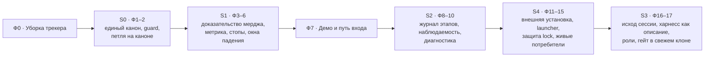

# Роадмеп Ralph после хакатона

**Дата**: 2026-10-26 (редакция 2)
**Статус**: утверждён человеком 26.10; рабочая раскладка карточек — `plan.md`, требования — `prd.md`

Две цели в этом порядке: петля, которой можно доверять ночью, и Ralph отдельным
продуктом, который можно попробовать со стороны. Наше отличие — автономный мердж
с доказательством безопасности на любом сильном агентном CLI. Ширина платформы
(интерфейс, бюджеты в деньгах, RAG) — не наша гонка.

| Ступень | Фазы  | Когда и кто                         | Что получаем                                                                                                                                 |
| ------- | ----- | ----------------------------------- | -------------------------------------------------------------------------------------------------------------------------------------------- |
| Ф0      | 0     | сейчас, человек и вахта             | трекер `pelmenya/ralph` отражает правду: 8 карточек закрыто, 12 переписано, старые вехи R0 закрыты                                           |
| S0      | 1–2   | неделя 26.10–01.11, человек и вахта | одно ядро вместо трёх копий; петля работает над продуктом, с guard и запретом второго writer                                                 |
| S1      | 3–6   | петля на каноне                     | мердж невозможен без доказательства; метрика доли задач в бюджет и счётчик пойманных отказов                                                 |
| Демо    | 7     | сразу после S1                      | человек со стороны по README доводит демо до мерджа                                                                                          |
| S2      | 8–10  | петля                               | рестарт продолжает с этапа, эффекты не дублируются, отказы читаются по логу                                                                  |
| S4      | 11–15 | петля + человек на решениях         | установка одной командой, update/rollback, оба потребителя на каноне, «фикс один раз»                                                        |
| S3      | 16–17 | петля                               | нейтральный исход сессии; харнесс подключается пакетом адаптера, барьеры по нормализованному событию; профили по canary, гейт в свежем клоне |

Вне роадмепа: несколько петель на одном репозитории (отдельный PRD после S4), брокер событий
и durable workflow, основной кодер на слабой модели, SaaS и графический интерфейс,
`visual-stand` как отдельный продукт (трекер SourceCraft-монорепо), Claude Code Projects
(трекер SourceCraft-монорепо — пересмотр по готовности локального запуска).
